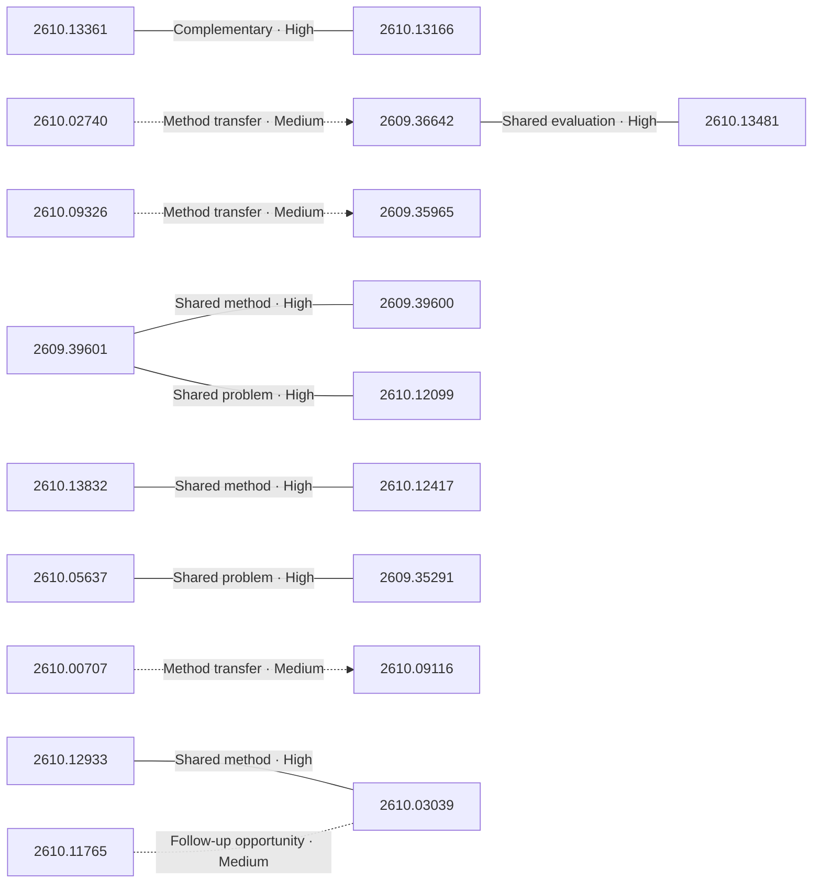

# Paper relationship graph — 2026-10-13

> [← Daily summary](../2026-10-13.md)

> **Interpretation caveat:** Every edge is an evidence-screened editorial hypothesis, not proof of citation, influence, priority, historical use, dependency, or an author-claimed relationship.

## Legend

- Rectangular nodes are current-day papers; rounded nodes are previously seen candidates.
- A line has no technical direction. An arrow shows only a proposed technical flow for an enabling dependency or method transfer.
- Solid edges are high confidence; dotted edges are medium confidence. Confidence evaluates this editorial connection, not either paper.
- Relationship labels:
  - **Shared problem:** `shared_problem`
  - **Shared method:** `shared_method`
  - **Shared evaluation:** `shared_evaluation`
  - **Complementary:** `complementary`
  - **Enabling dependency:** `enabling_dependency`
  - **Method transfer:** `method_transfer`
  - **Assumption tension:** `assumption_tension`
  - **Result tension:** `result_tension`
  - **Shared limitation:** `shared_limitation`
  - **Follow-up opportunity:** `follow_up_opportunity`

## Same-day relationships

| Source paper | Target paper | Relationship | Direction | Confidence |
| --- | --- | --- | --- | --- |
| [2609.39600](2609.39600.md) | [2609.39601](2609.39601.md) | Shared method | Not directional | High |
| [2609.35291](2609.35291.md) | [2610.05637](2610.05637.md) | Shared problem | Not directional | High |
| [2609.36642](2609.36642.md) | [2610.13481](2610.13481.md) | Shared evaluation | Not directional | High |
| [2610.02740](2610.02740.md) | [2609.36642](2609.36642.md) | Method transfer | Source → target | Medium |
| [2610.03039](2610.03039.md) | [2610.12933](2610.12933.md) | Shared method | Not directional | High |
| [2610.00707](2610.00707.md) | [2610.09116](2610.09116.md) | Method transfer | Source → target | Medium |
| [2610.13166](2610.13166.md) | [2610.13361](2610.13361.md) | Complementary | Not directional | High |
| [2610.12417](2610.12417.md) | [2610.13832](2610.13832.md) | Shared method | Not directional | High |
| [2610.09326](2610.09326.md) | [2609.35965](2609.35965.md) | Method transfer | Source → target | Medium |
| [2609.39601](2609.39601.md) | [2610.12099](2610.12099.md) | Shared problem | Not directional | High |
| [2610.11765](2610.11765.md) | [2610.03039](2610.03039.md) | Follow-up opportunity | Not directional | Medium |

## Connections to previously seen papers

_The visual diagram is omitted because this graph is too large or dense for a readable snapshot; every edge remains in the table below._

| New paper | Previously seen paper | First seen by service | Relationship | Technical direction | Confidence |
| --- | --- | --- | --- | --- | --- |
| [2609.36642](2609.36642.md) | 2609.20784 ([Hugging Face](https://huggingface.co/papers/2609.20784) · [arXiv](https://arxiv.org/abs/2609.20784)) | 2026-09-18 | Shared problem | Not directional | Medium |
| [2610.13481](2610.13481.md) | 2609.36864 ([Hugging Face](https://huggingface.co/papers/2609.36864) · [arXiv](https://arxiv.org/abs/2609.36864)) | 2026-09-30 | Shared method | Not directional | Medium |
| [2610.12099](2610.12099.md) | 2610.02840 ([Hugging Face](https://huggingface.co/papers/2610.02840) · [arXiv](https://arxiv.org/abs/2610.02840)) | 2026-10-05 | Shared method | Not directional | Medium |
| [2609.39601](2609.39601.md) | 2609.23863 ([Hugging Face](https://huggingface.co/papers/2609.23863) · [arXiv](https://arxiv.org/abs/2609.23863)) | 2026-09-22 | Shared problem | Not directional | Medium |
| [2610.03308](2610.03308.md) | 2610.08790 ([Hugging Face](https://huggingface.co/papers/2610.08790) · [arXiv](https://arxiv.org/abs/2610.08790)) | 2026-10-07 | Shared method | Not directional | Medium |
| [2610.13832](2610.13832.md) | 2608.19669 ([Hugging Face](https://huggingface.co/papers/2608.19669) · [arXiv](https://arxiv.org/abs/2608.19669)) | 2026-09-30 | Shared method | Not directional | Medium |
| [2610.13832](2610.13832.md) | 2609.38717 ([Hugging Face](https://huggingface.co/papers/2609.38717) · [arXiv](https://arxiv.org/abs/2609.38717)) | 2026-10-01 | Shared evaluation | Not directional | Medium |
| [2610.13166](2610.13166.md) | 2609.35025 ([Hugging Face](https://huggingface.co/papers/2609.35025) · [arXiv](https://arxiv.org/abs/2609.35025)) | 2026-09-30 | Shared problem | Not directional | Medium |
| [2610.13361](2610.13361.md) | 2609.33678 ([Hugging Face](https://huggingface.co/papers/2609.33678) · [arXiv](https://arxiv.org/abs/2609.33678)) | 2026-10-08 | Shared problem | Not directional | Medium |
| [2610.13361](2610.13361.md) | 2610.07967 ([Hugging Face](https://huggingface.co/papers/2610.07967) · [arXiv](https://arxiv.org/abs/2610.07967)) | 2026-10-08 | Complementary | Not directional | Medium |
| [2610.00707](2610.00707.md) | 2609.40340 ([Hugging Face](https://huggingface.co/papers/2609.40340) · [arXiv](https://arxiv.org/abs/2609.40340)) | 2026-10-01 | Follow-up opportunity | Not directional | Medium |
| [2610.05637](2610.05637.md) | 2609.10895 ([Hugging Face](https://huggingface.co/papers/2609.10895) · [arXiv](https://arxiv.org/abs/2609.10895)) | 2026-09-14 | Complementary | Not directional | Medium |

## Current paper key

| Paper | Analysis |
| --- | --- |
| 2609.39601 — GroundingPI: A Grounding Foundation Model towards Physical Intelligence with Visual Primitives | [Read analysis](2609.39601.md) |
| 2610.11765 — Thinking Inertia: LLMs Keep Thinking When Told Not To | [Read analysis](2610.11765.md) |
| 2610.13361 — AgentSWE: Can Coding Agents Build the Agent You Actually Want? | [Read analysis](2610.13361.md) |
| 2610.13166 — Scaling Agentic Data for Long-Horizon Terminal Intelligence | [Read analysis](2610.13166.md) |
| 2610.09326 — VIS-Ground: Video Interactive Storytelling with Contextual Grounding | [Read analysis](2610.09326.md) |
| 2609.39600 — GroundAnything: Reconciling Parallel Decoding with Precise Visual Grounding at Flash Speed | [Read analysis](2609.39600.md) |
| 2610.13630 — Multi-Stream Attention Residuals | [Read analysis](2610.13630.md) |
| 2609.33304 — Relevance Does Not Imply Applicability: Experience Activation for Personal GUI Agents | [Read analysis](2609.33304.md) |
| 2609.36642 — PR-OPD: Privileged Representation On-policy Self-Distillation for Agentic Reinforcement Learning | [Read analysis](2609.36642.md) |
| 2609.36616 — CrossTimeEdit: A Decade-Spanning Cross-View Dataset and Reward-Guided Editing for Historical Street-View Generation | [Read analysis](2609.36616.md) |
| 2610.13832 — SpatialASM: Internalizing Active Mentalization for Spatial Reasoning | [Read analysis](2610.13832.md) |
| 2610.03308 — T3lescope: Arbitrary-Resolution High-Fidelity Generative Surface Reconstruction from Images | [Read analysis](2610.03308.md) |
| 2609.35965 — Systematic Multi-Agent Vision-and-Language Navigation: Formulation, Benchmark, and Method | [Read analysis](2609.35965.md) |
| 2610.09396 — ARCS: Towards Precise Text-to-SQL via Structured Disambiguation | [Read analysis](2610.09396.md) |
| 2610.12933 — Learning More by Training Less: Uncertainty-Guided Progressive Contraction for Efficient Reasoning Post-Training | [Read analysis](2610.12933.md) |
| 2610.00707 — Initialization Improves LLM-Driven Discovery | [Read analysis](2610.00707.md) |
| 2610.13481 — Branching On-Policy Distillation | [Read analysis](2610.13481.md) |
| 2610.12417 — WOVEN: Weaving Visual World Modeling into Multimodal LLMs | [Read analysis](2610.12417.md) |
| 2610.05637 — Visual Grounding Safety in Vision-Language Models | [Read analysis](2610.05637.md) |
| 2610.12998 — Evaluating LLM Creativity through Long-Tail Performance | [Read analysis](2610.12998.md) |
| 2609.35291 — Narrow Multimodal Fine-Tuning Can Induce Emergent Misalignment | [Read analysis](2609.35291.md) |
| 2610.02740 — Prospective Hindsight: Self-Calibrating Reinforcement Learning via Prediction-Reality Gaps | [Read analysis](2610.02740.md) |
| 2610.03825 — Same Output, Different Gold: Measuring How Reference Choice Moves a Multilingual Benchmark Score | [Read analysis](2610.03825.md) |
| 2610.12099 — UNITAS: A 3D-Native World Action Model for Embodied Manipulation | [Read analysis](2610.12099.md) |
| 2610.09116 — SPLATIFY: Reproduce, Discover, Innovate! From Papers and Ideas to Trainable 3DGS Code | [Read analysis](2610.09116.md) |
| 2610.03039 — HyperThink: Text-to-Parameter Hypernetworks for Efficient Reasoning | [Read analysis](2610.03039.md) |

## Current papers without a published edge

- [2610.13630](2610.13630.md)
- [2609.33304](2609.33304.md)
- [2609.36616](2609.36616.md)
- [2610.09396](2610.09396.md)
- [2610.12998](2610.12998.md)
- [2610.03825](2610.03825.md)

---

[Support these research summaries on Buy Me a Coffee](https://buymeacoffee.com/vollero)
