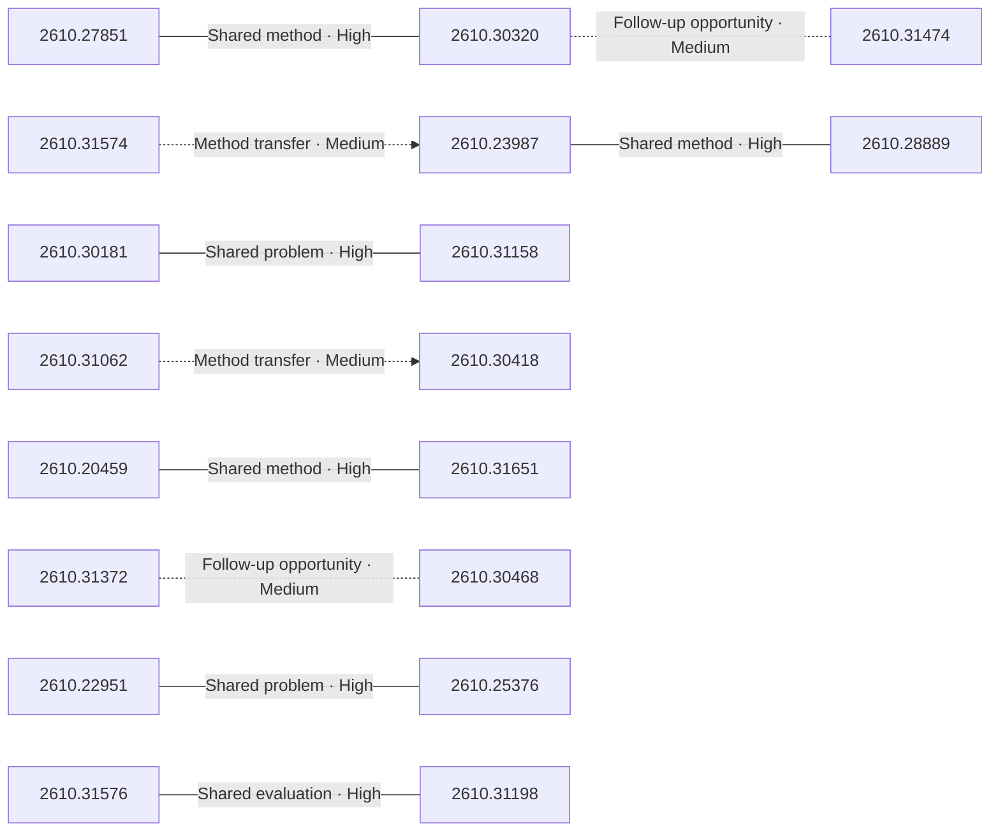

# Paper relationship graph — 2026-10-23

> [← Daily summary](../2026-10-23.md)

> **Interpretation caveat:** Every edge is an evidence-screened editorial hypothesis, not proof of citation, influence, priority, historical use, dependency, or an author-claimed relationship.

## Legend

- Rectangular nodes are current-day papers; rounded nodes are previously seen candidates.
- A line has no technical direction. An arrow shows only a proposed technical flow for an enabling dependency or method transfer.
- Solid edges are high confidence; dotted edges are medium confidence. Confidence evaluates this editorial connection, not either paper.
- Relationship labels:
  - **Shared problem:** `shared_problem`
  - **Shared method:** `shared_method`
  - **Shared evaluation:** `shared_evaluation`
  - **Complementary:** `complementary`
  - **Enabling dependency:** `enabling_dependency`
  - **Method transfer:** `method_transfer`
  - **Assumption tension:** `assumption_tension`
  - **Result tension:** `result_tension`
  - **Shared limitation:** `shared_limitation`
  - **Follow-up opportunity:** `follow_up_opportunity`

## Same-day relationships

| Source paper | Target paper | Relationship | Direction | Confidence |
| --- | --- | --- | --- | --- |
| [2610.20459](2610.20459.md) | [2610.31651](2610.31651.md) | Shared method | Not directional | High |
| [2610.23987](2610.23987.md) | [2610.28889](2610.28889.md) | Shared method | Not directional | High |
| [2610.30181](2610.30181.md) | [2610.31158](2610.31158.md) | Shared problem | Not directional | High |
| [2610.31198](2610.31198.md) | [2610.31576](2610.31576.md) | Shared evaluation | Not directional | High |
| [2610.22951](2610.22951.md) | [2610.25376](2610.25376.md) | Shared problem | Not directional | High |
| [2610.27851](2610.27851.md) | [2610.30320](2610.30320.md) | Shared method | Not directional | High |
| [2610.30468](2610.30468.md) | [2610.31372](2610.31372.md) | Follow-up opportunity | Not directional | Medium |
| [2610.31574](2610.31574.md) | [2610.23987](2610.23987.md) | Method transfer | Source → target | Medium |
| [2610.31062](2610.31062.md) | [2610.30418](2610.30418.md) | Method transfer | Source → target | Medium |
| [2610.30320](2610.30320.md) | [2610.31474](2610.31474.md) | Follow-up opportunity | Not directional | Medium |

## Connections to previously seen papers

_The visual diagram is omitted because this graph is too large or dense for a readable snapshot; every edge remains in the table below._

| New paper | Previously seen paper | First seen by service | Relationship | Technical direction | Confidence |
| --- | --- | --- | --- | --- | --- |
| [2610.04184](2610.04184.md) | 2609.35025 ([Hugging Face](https://huggingface.co/papers/2609.35025) · [arXiv](https://arxiv.org/abs/2609.35025)) | 2026-09-30 | Shared problem | Not directional | Medium |
| [2610.23987](2610.23987.md) | 2610.21459 ([Hugging Face](https://huggingface.co/papers/2610.21459) · [arXiv](https://arxiv.org/abs/2610.21459)) | 2026-10-19 | Shared problem | Not directional | Medium |
| [2610.22951](2610.22951.md) | 2610.05719 ([Hugging Face](https://huggingface.co/papers/2610.05719) · [arXiv](https://arxiv.org/abs/2610.05719)) | 2026-10-06 | Complementary | Not directional | Medium |
| [2610.26233](2610.26233.md) | 2610.07641 ([Hugging Face](https://huggingface.co/papers/2610.07641) · [arXiv](https://arxiv.org/abs/2610.07641)) | 2026-10-07 | Shared method | Not directional | Medium |
| [2610.27712](2610.27712.md) | 2610.13177 ([Hugging Face](https://huggingface.co/papers/2610.13177) · [arXiv](https://arxiv.org/abs/2610.13177)) | 2026-10-22 | Shared problem | Not directional | Medium |
| [2610.27851](2610.27851.md) | 2610.10515 ([Hugging Face](https://huggingface.co/papers/2610.10515) · [arXiv](https://arxiv.org/abs/2610.10515)) | 2026-10-08 | Shared method | Not directional | Medium |
| [2610.30418](2610.30418.md) | 2609.39050 ([Hugging Face](https://huggingface.co/papers/2609.39050) · [arXiv](https://arxiv.org/abs/2609.39050)) | 2026-10-05 | Shared problem | Not directional | Medium |
| [2610.30468](2610.30468.md) | 2610.28887 ([Hugging Face](https://huggingface.co/papers/2610.28887) · [arXiv](https://arxiv.org/abs/2610.28887)) | 2026-10-22 | Shared method | Not directional | Medium |
| [2610.30320](2610.30320.md) | 2610.03391 ([Hugging Face](https://huggingface.co/papers/2610.03391) · [arXiv](https://arxiv.org/abs/2610.03391)) | 2026-10-05 | Shared problem | Not directional | Medium |
| [2610.31198](2610.31198.md) | 2610.29441 ([Hugging Face](https://huggingface.co/papers/2610.29441) · [arXiv](https://arxiv.org/abs/2610.29441)) | 2026-10-22 | Shared method | Not directional | Medium |
| [2610.30753](2610.30753.md) | 2610.16577 ([Hugging Face](https://huggingface.co/papers/2610.16577) · [arXiv](https://arxiv.org/abs/2610.16577)) | 2026-10-14 | Complementary | Not directional | Medium |
| [2610.31466](2610.31466.md) | 2610.28630 ([Hugging Face](https://huggingface.co/papers/2610.28630) · [arXiv](https://arxiv.org/abs/2610.28630)) | 2026-10-21 | Shared problem | Not directional | Medium |

## Current paper key

| Paper | Analysis |
| --- | --- |
| 2610.31329 — WeVisOne-VL: Unified Visual Perception from Objects to Pixels | [Read analysis](2610.31329.md) |
| 2610.30926 — Making MLLM Latents Matter: Factor-Aware Predictive Learning for Cinematic Video Generation | [Read analysis](2610.30926.md) |
| 2610.30181 — Deep Search in Real-World Web Environments | [Read analysis](2610.30181.md) |
| 2610.24738 — Editing Images into Reusable Layers via Compositional Edit-Prior Distillation | [Read analysis](2610.24738.md) |
| 2610.30949 — IQuest-Q1: Advancing Foundation Capabilities for Agentic CLI Systems | [Read analysis](2610.30949.md) |
| 2610.29677 — Toward Recursive Self-Improvement in Physical AI | [Read analysis](2610.29677.md) |
| 2610.25100 — Deep Fusion Memory: A Chunk-Level Parametric Memory for Large Language Models | [Read analysis](2610.25100.md) |
| 2610.23987 — What Generation Knows: Unlocking Fine-Grained Understanding in Unified Multimodal Models | [Read analysis](2610.23987.md) |
| 2610.27851 — LaLa-World: Scaling Latent World Models with Natural Language Actions | [Read analysis](2610.27851.md) |
| 2610.30320 — Self-Distilling Future Video Representations for World Action Models | [Read analysis](2610.30320.md) |
| 2610.27598 — Meta Expert: Cross-Layer Expert Sharing for Storage- and Retrieval-Efficient MoE | [Read analysis](2610.27598.md) |
| 2610.28889 — Policy-Mask: Budget-Aware Adaptation of Diffusion Features to Discriminative Tasks | [Read analysis](2610.28889.md) |
| 2610.30753 — FilmFlow: Agentic System for 3D Virtual Film Cinematography | [Read analysis](2610.30753.md) |
| 2610.26233 — Heartbeat Thinking: Speculative Reasoning and Tool Execution While Listening in Realtime Voice Agents | [Read analysis](2610.26233.md) |
| 2610.28416 — Code2Video-Compass: A Comprehensive Benchmark for General-Purpose Code-Based Video Generation across T2V, I2V, and V2V | [Read analysis](2610.28416.md) |
| 2610.31158 — Beyond Watching and Searching: Benchmarking Agents for Video-centered Deep Research Reports | [Read analysis](2610.31158.md) |
| 2610.30418 — Agent Mosaic: Recognizing Confidentiality Leaks in Agentic LLM Systems | [Read analysis](2610.30418.md) |
| 2610.19705 — RouteWeaver: Weaving Mode Selection and Execution into Unified LLM Routing | [Read analysis](2610.19705.md) |
| 2610.27712 — RLSplat: Resource-Linear Budget Control for Feed-forward 3D Gaussian Splatting | [Read analysis](2610.27712.md) |
| 2610.30755 — Is Complex Agentic Memory Always Needed? Naive RAG Is Stronger Than We Thought | [Read analysis](2610.30755.md) |
| 2610.31305 — Cola2: Co-Adaptive Hierarchical Language Modeling with Continuous Semantic Compression and Balanced Discrete Generation | [Read analysis](2610.31305.md) |
| 2610.20091 — RTAformer: Relation-Transition-Aware Transformer for Video Scene Graph Generation | [Read analysis](2610.20091.md) |
| 2610.30866 — Verus-Insight: Towards Explainable Artifact Detection in AI-Generated Videos | [Read analysis](2610.30866.md) |
| 2610.31574 — Rethinking Sequence Compression with Test-time Regression | [Read analysis](2610.31574.md) |
| 2610.31494 — AgentVQA: A Unified Benchmark for Agentic Visual Understanding | [Read analysis](2610.31494.md) |
| 2610.31466 — AnyGameRenderer: Entity-Consistent Generative Rendering Across Games and an Entity-Level Benchmark | [Read analysis](2610.31466.md) |
| 2610.20459 — MolLean: A Process-Verifiable Language for Chemical Reasoning | [Read analysis](2610.20459.md) |
| 2610.30882 — Inherited, Not Invented: Tracing the Provenance of Wait in Reasoning Models | [Read analysis](2610.30882.md) |
| 2610.31372 — RIDAR: Safeguarding Research Integrity in Autonomous Research Agents via Automated Detection and Runtime Intervention | [Read analysis](2610.31372.md) |
| 2610.31062 — SCOPE: Compiling Natural-Language Policies into Neurosymbolic Predicate Programs | [Read analysis](2610.31062.md) |
| 2610.31668 — Reading, Writing, Sharing, and Interacting with the World through Video | [Read analysis](2610.31668.md) |
| 2610.31576 — What Makes a Good Unmasking Policy? A Controlled Study of Learned Unmasking in Diffusion Language Models | [Read analysis](2610.31576.md) |
| 2610.31623 — F2G-Pose: Geometry-Aware Foundation Feature Lifting for Direct RGB-D Category-Level Object Pose Estimation | [Read analysis](2610.31623.md) |
| 2610.30340 — Foundation4D: Towards a unified perception and reconstruction model for autonomous vehicles | [Read analysis](2610.30340.md) |
| 2610.31651 — BrickWright: Agentic Creation of Physically Feasible Brick Builds | [Read analysis](2610.31651.md) |
| 2610.22722 — The LLM-Attacker: A Unified Red-Team Framework for Privacy Evaluation of Split and Distributed LLM Systems | [Read analysis](2610.22722.md) |
| 2610.25835 — Diffusion Language Models Change Speed Across Tasks and Languages | [Read analysis](2610.25835.md) |
| 2610.28950 — HyperDrone: Simulation-to-Reality Transfer at Millions of Frames per Second | [Read analysis](2610.28950.md) |
| 2610.27148 — Who Takes the Lead? Model Ability and Task-Conditioned Collaboration with Humans | [Read analysis](2610.27148.md) |
| 2610.22951 — MambaAct: Efficient Mamba Action Experts for Flow-Matching Vision-Language-Action Models | [Read analysis](2610.22951.md) |
| 2610.30468 — SplatLab: Autonomous Scientific Discovery for 3DGS Research | [Read analysis](2610.30468.md) |
| 2610.25376 — TILDE: Teacher-in-the-Loop Distillation from Embodied Foundation Models | [Read analysis](2610.25376.md) |
| 2610.26252 — SEAM: Spectral Embedding Alignment and Merging for Low-Resource TTS | [Read analysis](2610.26252.md) |
| 2610.31474 — Skeleton-Grounded Latent Action Model for Robot World Models | [Read analysis](2610.31474.md) |
| 2610.04184 — EvalResearchBench: Can AI Agents Build Their Own Feedback for Recursive Self-Improvement? | [Read analysis](2610.04184.md) |
| 2610.31198 — Different Tasks, Different Timesteps: Temporal Task-Aware Quantization for Diffusion Language Models | [Read analysis](2610.31198.md) |
| 2610.24385 — Bridging Exploration and Persona: Information-Directed Dueling for Test-Time Agent Personalization | [Read analysis](2610.24385.md) |
| 2610.24383 — IF-MAP: Influence-Function-Inspired Agent Prioritization in Multi-Agent Systems | [Read analysis](2610.24383.md) |
| 2610.12586 — Realism VS Accuracy: Event Sequence Forecasting from a Generative Modeling Perspective | [Read analysis](2610.12586.md) |
| 2610.30043 — TARSphere: A Robot-Oriented Full-Stack Framework for Long-Horizon Embodied Agents in Evolving Physical and Social Environments | [Read analysis](2610.30043.md) |

## Current papers without a published edge

- [2610.31329](2610.31329.md)
- [2610.30926](2610.30926.md)
- [2610.24738](2610.24738.md)
- [2610.30949](2610.30949.md)
- [2610.29677](2610.29677.md)
- [2610.25100](2610.25100.md)
- [2610.27598](2610.27598.md)
- [2610.28416](2610.28416.md)
- [2610.19705](2610.19705.md)
- [2610.30755](2610.30755.md)
- [2610.31305](2610.31305.md)
- [2610.20091](2610.20091.md)
- [2610.30866](2610.30866.md)
- [2610.31494](2610.31494.md)
- [2610.30882](2610.30882.md)
- [2610.31668](2610.31668.md)
- [2610.31623](2610.31623.md)
- [2610.30340](2610.30340.md)
- [2610.22722](2610.22722.md)
- [2610.25835](2610.25835.md)
- [2610.28950](2610.28950.md)
- [2610.27148](2610.27148.md)
- [2610.26252](2610.26252.md)
- [2610.24385](2610.24385.md)
- [2610.24383](2610.24383.md)
- [2610.12586](2610.12586.md)
- [2610.30043](2610.30043.md)

---

[Support these research summaries on Buy Me a Coffee](https://buymeacoffee.com/vollero)
