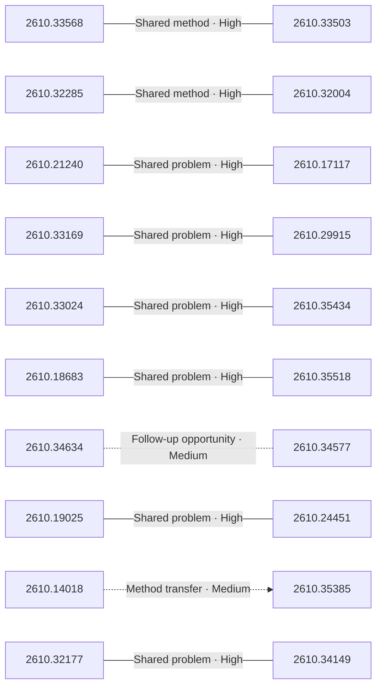

# Paper relationship graph — 2026-10-27

> [← Daily summary](../2026-10-27.md)

> **Interpretation caveat:** Every edge is an evidence-screened editorial hypothesis, not proof of citation, influence, priority, historical use, dependency, or an author-claimed relationship.

## Legend

- Rectangular nodes are current-day papers; rounded nodes are previously seen candidates.
- A line has no technical direction. An arrow shows only a proposed technical flow for an enabling dependency or method transfer.
- Solid edges are high confidence; dotted edges are medium confidence. Confidence evaluates this editorial connection, not either paper.
- Relationship labels:
  - **Shared problem:** `shared_problem`
  - **Shared method:** `shared_method`
  - **Shared evaluation:** `shared_evaluation`
  - **Complementary:** `complementary`
  - **Enabling dependency:** `enabling_dependency`
  - **Method transfer:** `method_transfer`
  - **Assumption tension:** `assumption_tension`
  - **Result tension:** `result_tension`
  - **Shared limitation:** `shared_limitation`
  - **Follow-up opportunity:** `follow_up_opportunity`

## Same-day relationships

| Source paper | Target paper | Relationship | Direction | Confidence |
| --- | --- | --- | --- | --- |
| [2610.17117](2610.17117.md) | [2610.21240](2610.21240.md) | Shared problem | Not directional | High |
| [2610.18683](2610.18683.md) | [2610.35518](2610.35518.md) | Shared problem | Not directional | High |
| [2610.19025](2610.19025.md) | [2610.24451](2610.24451.md) | Shared problem | Not directional | High |
| [2610.29915](2610.29915.md) | [2610.33169](2610.33169.md) | Shared problem | Not directional | High |
| [2610.32004](2610.32004.md) | [2610.32285](2610.32285.md) | Shared method | Not directional | High |
| [2610.33503](2610.33503.md) | [2610.33568](2610.33568.md) | Shared method | Not directional | High |
| [2610.33024](2610.33024.md) | [2610.35434](2610.35434.md) | Shared problem | Not directional | High |
| [2610.32177](2610.32177.md) | [2610.34149](2610.34149.md) | Shared problem | Not directional | High |
| [2610.14018](2610.14018.md) | [2610.35385](2610.35385.md) | Method transfer | Source → target | Medium |
| [2610.34577](2610.34577.md) | [2610.34634](2610.34634.md) | Follow-up opportunity | Not directional | Medium |

## Connections to previously seen papers

_The visual diagram is omitted because this graph is too large or dense for a readable snapshot; every edge remains in the table below._

| New paper | Previously seen paper | First seen by service | Relationship | Technical direction | Confidence |
| --- | --- | --- | --- | --- | --- |
| [2610.23928](2610.23928.md) | 2610.07043 ([Hugging Face](https://huggingface.co/papers/2610.07043) · [arXiv](https://arxiv.org/abs/2610.07043)) | 2026-10-07 | Shared problem | Not directional | High |
| [2610.33512](2610.33512.md) | 2609.38847 ([Hugging Face](https://huggingface.co/papers/2609.38847) · [arXiv](https://arxiv.org/abs/2609.38847)) | 2026-10-14 | Shared problem | Not directional | High |
| [2610.34634](2610.34634.md) | 2610.28679 ([Hugging Face](https://huggingface.co/papers/2610.28679) · [arXiv](https://arxiv.org/abs/2610.28679)) | 2026-10-22 | Shared problem | Not directional | High |
| [2610.32004](2610.32004.md) | 2610.20424 ([Hugging Face](https://huggingface.co/papers/2610.20424) · [arXiv](https://arxiv.org/abs/2610.20424)) | 2026-10-19 | Shared evaluation | Not directional | High |
| [2610.34356](2610.34356.md) | 2609.31394 ([Hugging Face](https://huggingface.co/papers/2609.31394) · [arXiv](https://arxiv.org/abs/2609.31394)) | 2026-09-28 | Shared method | Not directional | Medium |
| [2610.29915](2610.29915.md) | 2610.14293 ([Hugging Face](https://huggingface.co/papers/2610.14293) · [arXiv](https://arxiv.org/abs/2610.14293)) | 2026-10-14 | Shared problem | Not directional | High |
| [2610.33135](2610.33135.md) | 2609.34722 ([Hugging Face](https://huggingface.co/papers/2609.34722) · [arXiv](https://arxiv.org/abs/2609.34722)) | 2026-09-29 | Shared method | Not directional | High |
| [2610.33024](2610.33024.md) | 2610.27435 ([Hugging Face](https://huggingface.co/papers/2610.27435) · [arXiv](https://arxiv.org/abs/2610.27435)) | 2026-10-21 | Shared method | Not directional | Medium |
| [2610.34577](2610.34577.md) | 2610.00972 ([Hugging Face](https://huggingface.co/papers/2610.00972) · [arXiv](https://arxiv.org/abs/2610.00972)) | 2026-10-05 | Shared method | Not directional | High |
| [2610.35295](2610.35295.md) | 2609.38972 ([Hugging Face](https://huggingface.co/papers/2609.38972) · [arXiv](https://arxiv.org/abs/2609.38972)) | 2026-10-07 | Shared problem | Not directional | High |
| [2610.33568](2610.33568.md) | 2609.36887 ([Hugging Face](https://huggingface.co/papers/2609.36887) · [arXiv](https://arxiv.org/abs/2609.36887)) | 2026-10-05 | Shared method | Not directional | High |
| [2610.34149](2610.34149.md) | 2610.21783 ([Hugging Face](https://huggingface.co/papers/2610.21783) · [arXiv](https://arxiv.org/abs/2610.21783)) | 2026-10-19 | Follow-up opportunity | Not directional | Medium |

## Current paper key

| Paper | Analysis |
| --- | --- |
| 2610.33568 — Trajectory2Gym: Decision-Grounded Compositional Interaction Synthesis for Tool-Use Agents | [Read analysis](2610.33568.md) |
| 2610.32285 — Trial by Trace: Benchmarking AI Agent Harnesses for Reliability and Failure Attribution | [Read analysis](2610.32285.md) |
| 2610.34662 — StreamVibe: Proactive Video Agents for Evolving User Intent | [Read analysis](2610.34662.md) |
| 2610.34467 — DynaFlow: Learning Free-Form Multi-Agent Orchestration | [Read analysis](2610.34467.md) |
| 2610.33966 — InteractiveWorld: A Verifiable Human-Centric Environment for Building Better Interactive MLLM Assistants | [Read analysis](2610.33966.md) |
| 2610.35845 — Work Agents: Systems, Capabilities, and Optimization | [Read analysis](2610.35845.md) |
| 2610.33956 — Continual Learning Exam: Benchmarking Long-Horizon RSI and Experiential Learning in LLM Agents | [Read analysis](2610.33956.md) |
| 2610.33135 — WorldCast: World-Consistent Character Video Generation with Large-Angle Camera Control | [Read analysis](2610.33135.md) |
| 2610.34415 — Spatial Audio Generation and Editing with Executable Plans and Self-Distilling Transfusion | [Read analysis](2610.34415.md) |
| 2610.33413 — AV-FABLE: Audio-Visual Manipulation Forensics in Long-Form Videos | [Read analysis](2610.33413.md) |
| 2610.33512 — Eat Your Precision: Precision Objective Mitigates Reward Hacking in Rubric-based RL | [Read analysis](2610.33512.md) |
| 2610.21240 — Representation Redistribution in Sparse Autoencoders | [Read analysis](2610.21240.md) |
| 2610.32195 — Principia: Test-Time Hypotheses to Principle Construction for Scientific Discovery | [Read analysis](2610.32195.md) |
| 2610.31635 — HiP3R: Hierarchical Pose Graphs for Long-Horizon 3D Reconstruction | [Read analysis](2610.31635.md) |
| 2610.33472 — Qwen-Image-PE: Learning Visual Design for Text-to-Image Prompt Enhancement | [Read analysis](2610.33472.md) |
| 2610.33169 — World-in-Context: Interactive Video World Modeling with In-Context Conditioning | [Read analysis](2610.33169.md) |
| 2610.34238 — Δτ-Bench: Pushing Agents Toward a Moving Capability | [Read analysis](2610.34238.md) |
| 2610.35193 — Trustworthy Recursive Self-Improvement in the Era of Large Models: Foundation, Risks, Evaluation and Open Challenges | [Read analysis](2610.35193.md) |
| 2610.33024 — Evolving to Match Capabilities: Improving Harness Self-Evolution via Skill Adaptation | [Read analysis](2610.33024.md) |
| 2610.23928 — miniTE: Diagnosing and Bridging the Execution Gap in Native NVFP4 Reinforcement Learning | [Read analysis](2610.23928.md) |
| 2610.18683 — ProAS: A Progress-Aware Advantage Shaping Framework for Multi-Turn Agentic Reinforcement Learning | [Read analysis](2610.18683.md) |
| 2610.35518 — S3AC: Stabilized, Selective, and Scalable Actor-Critic for LLM Reasoning | [Read analysis](2610.35518.md) |
| 2610.35385 — EmbodiedLab: Benchmarking Embodied Agents That Act to Know | [Read analysis](2610.35385.md) |
| 2610.29915 — CausalAlign: Causal Alignment of Video Generation Models for Consistent Ego-Motion | [Read analysis](2610.29915.md) |
| 2610.34356 — RynnVLA-Latent: Scaling Robotic Manipulation Foundation Models with 3D-Grounded Latent Actions | [Read analysis](2610.34356.md) |
| 2610.33079 — Rethinking Video Storage for AI Training: Breaking Cross-Frame Dependencies for Efficient Random Access | [Read analysis](2610.33079.md) |
| 2610.33845 — Build, Don't Play: Self-Improving LLM Research Agents Develop a Hearthstone Battlegrounds AI That Rivals Top Players | [Read analysis](2610.33845.md) |
| 2610.31309 — Extreme Compression of Per-Layer Embeddings via Cross-Layer Latent Vector Quantization | [Read analysis](2610.31309.md) |
| 2610.34735 — iPrefBench: A User-Centric Benchmark for Personalized Mobile Use Agents | [Read analysis](2610.34735.md) |
| 2610.35001 — More Memory, Better Videos? A Controlled Study of Visual Memory in Long-Video Generation | [Read analysis](2610.35001.md) |
| 2610.33861 — ReGE: Stronger Agents through Experience Synthesis | [Read analysis](2610.33861.md) |
| 2610.34634 — AgentProofBench: Benchmarking Reusable Verifiers for Web Agents | [Read analysis](2610.34634.md) |
| 2610.19025 — How Far Can Coding Agents Go in Visual Generation? | [Read analysis](2610.19025.md) |
| 2610.34654 — Thinking-in-Bets at Test Time Reduces Sycophantic Revisions in LLM Agents | [Read analysis](2610.34654.md) |
| 2610.33608 — Mycelium: A Meta-Study of Hallucination Detection Across Provenance, Typology, and Granularities | [Read analysis](2610.33608.md) |
| 2610.33503 — Novel or Not? PatEx-Gym: Agentic Prior-Art Search for Novelty Assessment in Patent Examination | [Read analysis](2610.33503.md) |
| 2610.34386 — ParetoRSI-Gym: Can AI Agents Improve Language Models Across Multiple Domains? | [Read analysis](2610.34386.md) |
| 2610.33718 — RoboJev: An Open Vision-Language Judge for Robot Success Detection | [Read analysis](2610.33718.md) |
| 2610.14018 — RoboHarness: A Simple Harness Outperforms VLA and World Action Models | [Read analysis](2610.14018.md) |
| 2610.34241 — Beyond Benchmarks: Can Small Open-Weight Models Get Real Coding Work Done? | [Read analysis](2610.34241.md) |
| 2610.31818 — Nested Sparsity for Scalable Pretraining and Continual Learning | [Read analysis](2610.31818.md) |
| 2610.32004 — CRM-Agent-Bench: Benchmarking Tool-Using Agents in Stateful Enterprise Environments | [Read analysis](2610.32004.md) |
| 2610.35450 — OBB-PBD: Extending Parallel Box Decoding to Oriented Bounding Boxes for Referring Expression Grounding in Aerial Imagery | [Read analysis](2610.35450.md) |
| 2610.35328 — Constrained Decoding: Harmful or Beneficial? Revisiting Its Impact on LLM Performance | [Read analysis](2610.35328.md) |
| 2610.33732 — Trust Mechanisms for Offline Generative AI at the Edge: A Connectivity-Regime Framework and an Empirical Study on a Raspberry Pi 5 | [Read analysis](2610.33732.md) |
| 2610.30970 — Joint or Per-Option? Compact Encoders for Closed-Set Decisions from 17 Million to 1 Billion Parameters | [Read analysis](2610.30970.md) |
| 2610.29139 — Steering Black-Box Large Language Model Agents with Pitfall Anticipation World Model | [Read analysis](2610.29139.md) |
| 2610.34577 — Rethinking Verification in Agent Harnesses | [Read analysis](2610.34577.md) |
| 2610.21561 — DialFork: Going Beyond Factuality to Evaluate Procedural Hallucination in Conversational Agents | [Read analysis](2610.21561.md) |
| 2610.24451 — Assessing the CAD Capabilities of General-Purpose AI Models: A Case Study of GPT-6 Astra | [Read analysis](2610.24451.md) |
| 2610.35434 — Skill^{infty}: Recursive Self-Improvement for Agent Skill Optimization | [Read analysis](2610.35434.md) |
| 2610.33877 — Semantic Concept Steering Breaks the Explanation Drift Loop in Continual Learning | [Read analysis](2610.33877.md) |
| 2610.34638 — Intrinsic Goals for Autonomous Agents: Hierarchical Exploration Captures Future Volitional Action in Drosophila | [Read analysis](2610.34638.md) |
| 2610.32177 — Ψ-0.6: Adaptive Streams of Thought in a Unified Vision-Language World Model | [Read analysis](2610.32177.md) |
| 2610.33817 — EnvLunch: The Environment as a Free Lunch for Learning to Interact | [Read analysis](2610.33817.md) |
| 2610.35295 — Did the Model Use That? Counterfactual Training Boosts Self-Attribution in Language Models | [Read analysis](2610.35295.md) |
| 2610.34149 — Humans in Space: Can MLLMs Construct Human-Centric Spatial Understanding via Active Exocentric Exploration? | [Read analysis](2610.34149.md) |
| 2610.36420 — SO-101 Bench: Accessible Spatial Manipulation | [Read analysis](2610.36420.md) |
| 2610.17117 — Gluing Local Contexts into Global Meaning: A Sheaf-Theoretic Decomposition of Transformer Representations | [Read analysis](2610.17117.md) |
| 2610.34886 — ThinkBit: Search Codewords, Recalibrate Scales, Select by Reasoning | [Read analysis](2610.34886.md) |
| 2610.28490 — Learning from Automatic 3D Gaussian Splatting Edits for Online Bayesian Scene Change Detection | [Read analysis](2610.28490.md) |
| 2610.33005 — OpenESM: Energy-Steered Models Are Scalable Foundation Learners | [Read analysis](2610.33005.md) |
| 2610.31566 — CellTrack-Bench: Microscopic Cell Tracking Benchmark for Vision-Language Models | [Read analysis](2610.31566.md) |

## Current papers without a published edge

- [2610.34662](2610.34662.md)
- [2610.34467](2610.34467.md)
- [2610.33966](2610.33966.md)
- [2610.35845](2610.35845.md)
- [2610.33956](2610.33956.md)
- [2610.34415](2610.34415.md)
- [2610.33413](2610.33413.md)
- [2610.32195](2610.32195.md)
- [2610.31635](2610.31635.md)
- [2610.33472](2610.33472.md)
- [2610.34238](2610.34238.md)
- [2610.35193](2610.35193.md)
- [2610.33079](2610.33079.md)
- [2610.33845](2610.33845.md)
- [2610.31309](2610.31309.md)
- [2610.34735](2610.34735.md)
- [2610.35001](2610.35001.md)
- [2610.33861](2610.33861.md)
- [2610.34654](2610.34654.md)
- [2610.33608](2610.33608.md)
- [2610.34386](2610.34386.md)
- [2610.33718](2610.33718.md)
- [2610.34241](2610.34241.md)
- [2610.31818](2610.31818.md)
- [2610.35450](2610.35450.md)
- [2610.35328](2610.35328.md)
- [2610.33732](2610.33732.md)
- [2610.30970](2610.30970.md)
- [2610.29139](2610.29139.md)
- [2610.21561](2610.21561.md)
- [2610.33877](2610.33877.md)
- [2610.34638](2610.34638.md)
- [2610.33817](2610.33817.md)
- [2610.36420](2610.36420.md)
- [2610.34886](2610.34886.md)
- [2610.28490](2610.28490.md)
- [2610.33005](2610.33005.md)
- [2610.31566](2610.31566.md)

---

[Support these research summaries on Buy Me a Coffee](https://buymeacoffee.com/vollero)
