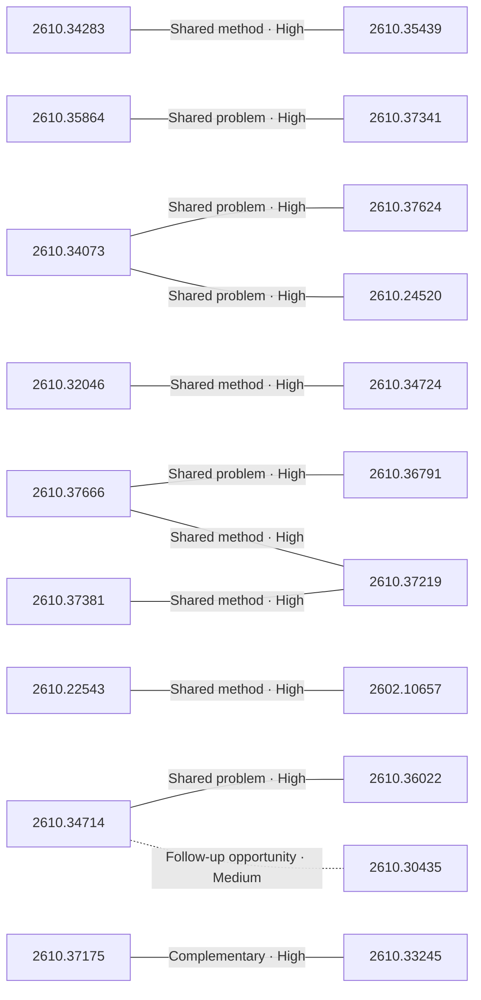

# Paper relationship graph — 2026-10-28

> [← Daily summary](../2026-10-28.md)

> **Interpretation caveat:** Every edge is an evidence-screened editorial hypothesis, not proof of citation, influence, priority, historical use, dependency, or an author-claimed relationship.

## Legend

- Rectangular nodes are current-day papers; rounded nodes are previously seen candidates.
- A line has no technical direction. An arrow shows only a proposed technical flow for an enabling dependency or method transfer.
- Solid edges are high confidence; dotted edges are medium confidence. Confidence evaluates this editorial connection, not either paper.
- Relationship labels:
  - **Shared problem:** `shared_problem`
  - **Shared method:** `shared_method`
  - **Shared evaluation:** `shared_evaluation`
  - **Complementary:** `complementary`
  - **Enabling dependency:** `enabling_dependency`
  - **Method transfer:** `method_transfer`
  - **Assumption tension:** `assumption_tension`
  - **Result tension:** `result_tension`
  - **Shared limitation:** `shared_limitation`
  - **Follow-up opportunity:** `follow_up_opportunity`

## Same-day relationships

| Source paper | Target paper | Relationship | Direction | Confidence |
| --- | --- | --- | --- | --- |
| [2610.24520](2610.24520.md) | [2610.34073](2610.34073.md) | Shared problem | Not directional | High |
| [2610.34073](2610.34073.md) | [2610.37624](2610.37624.md) | Shared problem | Not directional | High |
| [2610.32046](2610.32046.md) | [2610.34724](2610.34724.md) | Shared method | Not directional | High |
| [2610.30435](2610.30435.md) | [2610.34714](2610.34714.md) | Follow-up opportunity | Not directional | Medium |
| [2610.33245](2610.33245.md) | [2610.37175](2610.37175.md) | Complementary | Not directional | High |
| [2610.34283](2610.34283.md) | [2610.35439](2610.35439.md) | Shared method | Not directional | High |
| [2610.35864](2610.35864.md) | [2610.37341](2610.37341.md) | Shared problem | Not directional | High |
| [2610.37219](2610.37219.md) | [2610.37381](2610.37381.md) | Shared method | Not directional | High |
| [2610.37219](2610.37219.md) | [2610.37666](2610.37666.md) | Shared method | Not directional | High |
| [2610.36791](2610.36791.md) | [2610.37666](2610.37666.md) | Shared problem | Not directional | High |
| [2602.10657](2602.10657.md) | [2610.22543](2610.22543.md) | Shared method | Not directional | High |
| [2610.34714](2610.34714.md) | [2610.36022](2610.36022.md) | Shared problem | Not directional | High |

## Connections to previously seen papers

_The visual diagram is omitted because this graph is too large or dense for a readable snapshot; every edge remains in the table below._

| New paper | Previously seen paper | First seen by service | Relationship | Technical direction | Confidence |
| --- | --- | --- | --- | --- | --- |
| [2610.36791](2610.36791.md) | 2610.34356 ([Hugging Face](https://huggingface.co/papers/2610.34356) · [arXiv](https://arxiv.org/abs/2610.34356)) | 2026-10-27 | Enabling dependency | Previous → new | High |
| [2610.36082](2610.36082.md) | 2609.37915 ([Hugging Face](https://huggingface.co/papers/2609.37915) · [arXiv](https://arxiv.org/abs/2609.37915)) | 2026-10-01 | Shared problem | Not directional | Medium |
| [2610.22543](2610.22543.md) | 2610.04875 ([Hugging Face](https://huggingface.co/papers/2610.04875) · [arXiv](https://arxiv.org/abs/2610.04875)) | 2026-10-09 | Complementary | Not directional | Medium |
| [2610.26030](2610.26030.md) | 2610.01153 ([Hugging Face](https://huggingface.co/papers/2610.01153) · [arXiv](https://arxiv.org/abs/2610.01153)) | 2026-10-05 | Follow-up opportunity | Not directional | Medium |
| [2610.22684](2610.22684.md) | 2610.29784 ([Hugging Face](https://huggingface.co/papers/2610.29784) · [arXiv](https://arxiv.org/abs/2610.29784)) | 2026-10-22 | Shared problem | Not directional | Medium |
| [2610.34073](2610.34073.md) | 2610.29357 ([Hugging Face](https://huggingface.co/papers/2610.29357) · [arXiv](https://arxiv.org/abs/2610.29357)) | 2026-10-22 | Shared method | Not directional | Medium |
| [2610.32046](2610.32046.md) | 2610.08048 ([Hugging Face](https://huggingface.co/papers/2610.08048) · [arXiv](https://arxiv.org/abs/2610.08048)) | 2026-10-07 | Shared method | Not directional | Medium |
| [2610.36729](2610.36729.md) | 2610.33169 ([Hugging Face](https://huggingface.co/papers/2610.33169) · [arXiv](https://arxiv.org/abs/2610.33169)) | 2026-10-27 | Shared method | Not directional | Medium |
| [2610.37381](2610.37381.md) | 2610.21306 ([Hugging Face](https://huggingface.co/papers/2610.21306) · [arXiv](https://arxiv.org/abs/2610.21306)) | 2026-10-16 | Shared method | Not directional | Medium |
| [2610.37219](2610.37219.md) | 2610.09695 ([Hugging Face](https://huggingface.co/papers/2610.09695) · [arXiv](https://arxiv.org/abs/2610.09695)) | 2026-10-16 | Shared method | Not directional | Medium |
| [2610.37175](2610.37175.md) | 2610.15368 ([Hugging Face](https://huggingface.co/papers/2610.15368) · [arXiv](https://arxiv.org/abs/2610.15368)) | 2026-10-16 | Shared problem | Not directional | Medium |
| [2610.36077](2610.36077.md) | 2610.28601 ([Hugging Face](https://huggingface.co/papers/2610.28601) · [arXiv](https://arxiv.org/abs/2610.28601)) | 2026-10-21 | Shared method | Not directional | Medium |

## Current paper key

| Paper | Analysis |
| --- | --- |
| 2610.36077 — The Trinity:Capability-Driven Recursive Self-Improvement for Multimodal Agents | [Read analysis](2610.36077.md) |
| 2610.35013 — Multiscale Policy Optimization for Long-Horizon LLM Agents | [Read analysis](2610.35013.md) |
| 2610.34283 — ChronoReplay: One Answer Interface Is Not Enough for Streaming Spatial Intelligence | [Read analysis](2610.34283.md) |
| 2610.35864 — VibeVideoBench: Evaluating Multimodal Agents on Code-Driven Video Generation | [Read analysis](2610.35864.md) |
| 2610.34073 — Memory Tax: Dissecting the Net Value of Agent Memory | [Read analysis](2610.34073.md) |
| 2610.37381 — PDRVLA: A Vision-Language-Action Model with Physical Dynamics Representations | [Read analysis](2610.37381.md) |
| 2610.32046 — Can Test-Time Memory Evolution Outperform Test-Time Training for Scientific Discovery? | [Read analysis](2610.32046.md) |
| 2610.36729 — Hy-Nomas: Towards Free-form Interactive World Generation | [Read analysis](2610.36729.md) |
| 2610.37662 — Can Discrete Tokens Serve as Semantically Lossless Representations of Visual Signals? | [Read analysis](2610.37662.md) |
| 2610.24520 — HABIT-Bench: Evaluating Habit Induction from Longitudinal Weak Evidence in Agent Memory | [Read analysis](2610.24520.md) |
| 2610.36068 — Rollback: Experience Backtracking in World Models for Policy Improvement | [Read analysis](2610.36068.md) |
| 2610.37666 — ThinkWorld: World Imagination Reinforces Chain-of-Dynamics Reasoning | [Read analysis](2610.37666.md) |
| 2610.37341 — CodeCap-Bench: Can Code Serve as a Good Video Caption? | [Read analysis](2610.37341.md) |
| 2610.36456 — LociArt: A Unified Paradigm for Free-Style Local Video Stylization | [Read analysis](2610.36456.md) |
| 2610.37037 — Zooming without Zooming v2: From Seeing Details to Connecting Evidence for Generalizable Multimodal Perception | [Read analysis](2610.37037.md) |
| 2610.37364 — EmbeddingGemma 2: Unified and Efficient Multimodal Representations | [Read analysis](2610.37364.md) |
| 2610.33624 — RSI Arena: Towards Recursive Self-Improvement with Human Feedback | [Read analysis](2610.33624.md) |
| 2610.35724 — MatAnyone-E: Sparse Memory Propagation for Efficient High-Resolution Video Matting | [Read analysis](2610.35724.md) |
| 2610.35962 — h1: A Taste of the Bitter Lesson in Automated Theorem Proving | [Read analysis](2610.35962.md) |
| 2610.35439 — Omni-InteractScope: Benchmarking Proactive and Agentic Interaction in Continuous Omnimodal Streams | [Read analysis](2610.35439.md) |
| 2610.37386 — Channel Selection for Mixture-of-Experts Decoding Needs No Calibration Data | [Read analysis](2610.37386.md) |
| 2610.34491 — What Effort Level Should I Choose? On the Economics of Reasoning Effort in LLM Agents | [Read analysis](2610.34491.md) |
| 2610.22543 — On the SPOT: Enhancing Speculative Decoding for Diffusion Language Models via Commit-Order Prediction | [Read analysis](2610.22543.md) |
| 2610.36269 — Cross-modal Steering Vectors Exist Across Both Image and Text Generation | [Read analysis](2610.36269.md) |
| 2602.10657 — The Lexical Imprint of Pre-training Data | [Read analysis](2602.10657.md) |
| 2610.36791 — RynnWorld-Latent: A Cross-Embodiment World Model Conditioned on Universal Latent Actions | [Read analysis](2610.36791.md) |
| 2610.36466 — Nemotron-Labs-Diffusion-Uni: Elastic Self-Refining Unified Diffusion LLM with Cross-Paradigm On-Policy Distillation | [Read analysis](2610.36466.md) |
| 2610.34674 — Benchmarking Obstacle-Conditioned Safety in Household Robot Navigation | [Read analysis](2610.34674.md) |
| 2610.37255 — Your Policy Is Secretly a Harness: The Decision Geometry of Agent Interfaces | [Read analysis](2610.37255.md) |
| 2610.34714 — SearchHorizonBench: A Benchmark for Search Value in AI Agents | [Read analysis](2610.34714.md) |
| 2610.37649 — Can LLMs Uncover Hidden Physical Laws through Free Exploration? | [Read analysis](2610.37649.md) |
| 2610.37585 — Timestral | [Read analysis](2610.37585.md) |
| 2610.33066 — OvisOCR3 Technical Report | [Read analysis](2610.33066.md) |
| 2610.34724 — Harness-Model Collaboration for Long-Horizon Continual Learning | [Read analysis](2610.34724.md) |
| 2610.37624 — Rare, Relevant, and Still Wrong: How Memory Fails LLM Group Decisions | [Read analysis](2610.37624.md) |
| 2610.37219 — Vision-Language-Action or World-Action? Just Action Models | [Read analysis](2610.37219.md) |
| 2610.36022 — Learning and Reasoning with Geometry: How Generation Helps Spatial Understanding | [Read analysis](2610.36022.md) |
| 2610.34894 — What Outcome RL Buys: Finishing, Reliability, Rarely Reach | [Read analysis](2610.34894.md) |
| 2610.36082 — How Much Does the Hint Matter? Scope Conditions for Hindsight Self-Distillation in Financial Reasoning | [Read analysis](2610.36082.md) |
| 2610.37175 — MLE-World: Predicting Machine Learning Experiment Outcomes with a Learned World Model | [Read analysis](2610.37175.md) |
| 2610.31924 — Sub-monolayer tracking of molecular states at buried interfaces | [Read analysis](2610.31924.md) |
| 2610.36192 — Beyond the Estimate: Wiener-Informed Decoding for Easier Training of Pixel-Space Flow Models | [Read analysis](2610.36192.md) |
| 2610.30435 — Self-Assessment Reinforcement Learning for Search-State Awareness in Retrieval-Augmented Large Language Models | [Read analysis](2610.30435.md) |
| 2509.05512 — Quaternion Approximate Networks for Enhanced Image Classification and Oriented Object Detection | [Read analysis](2509.05512.md) |
| 2610.22684 — AlphaBet: Reinforcement Learning for LLM Event Forecasting Agents | [Read analysis](2610.22684.md) |
| 2610.29003 — T-DIG: Text-Conditioned Diversity for Image Generation | [Read analysis](2610.29003.md) |
| 2610.26030 — Truncate or Not? A Scaling Study of Looped Transformers with Truncated Backpropagation | [Read analysis](2610.26030.md) |
| 2610.34921 — PhysEvolve: Verifier-grounded Self-evolution for Physical Reasoning with Executable Worlds | [Read analysis](2610.34921.md) |
| 2610.26185 — MoveBench: A Rubric-Based Benchmark for Evaluating Large Language Models in Sports and Health Coaching | [Read analysis](2610.26185.md) |
| 2610.33245 — AdaPRA: Process Reward Agents with Adaptive Rubrics for Data Science | [Read analysis](2610.33245.md) |
| 2610.36184 — Lipi-Ghor: A Large-Scale, Diarized, Multi-Domain Bengali Speech Corpus and a Scalable Pipeline for Building It | [Read analysis](2610.36184.md) |

## Current papers without a published edge

- [2610.35013](2610.35013.md)
- [2610.37662](2610.37662.md)
- [2610.36068](2610.36068.md)
- [2610.36456](2610.36456.md)
- [2610.37037](2610.37037.md)
- [2610.37364](2610.37364.md)
- [2610.33624](2610.33624.md)
- [2610.35724](2610.35724.md)
- [2610.35962](2610.35962.md)
- [2610.37386](2610.37386.md)
- [2610.34491](2610.34491.md)
- [2610.36269](2610.36269.md)
- [2610.36466](2610.36466.md)
- [2610.34674](2610.34674.md)
- [2610.37255](2610.37255.md)
- [2610.37649](2610.37649.md)
- [2610.37585](2610.37585.md)
- [2610.33066](2610.33066.md)
- [2610.34894](2610.34894.md)
- [2610.31924](2610.31924.md)
- [2610.36192](2610.36192.md)
- [2509.05512](2509.05512.md)
- [2610.29003](2610.29003.md)
- [2610.34921](2610.34921.md)
- [2610.26185](2610.26185.md)
- [2610.36184](2610.36184.md)

---

[Support these research summaries on Buy Me a Coffee](https://buymeacoffee.com/vollero)
