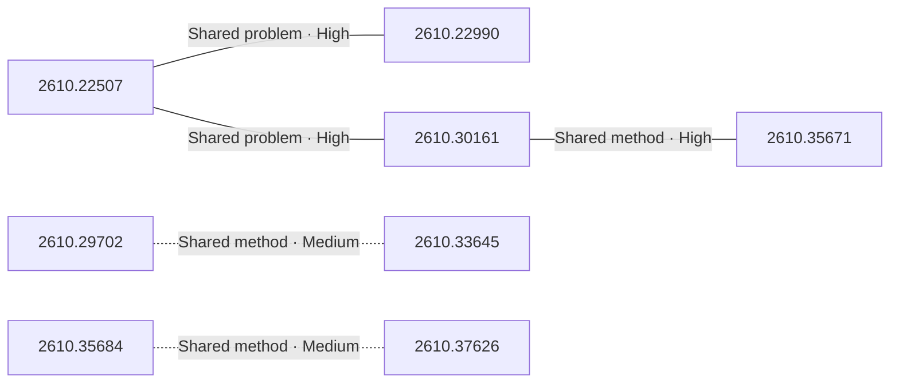

# Paper relationship graph — 2026-10-29

> [← Daily summary](../2026-10-29.md)

> **Interpretation caveat:** Every edge is an evidence-screened editorial hypothesis, not proof of citation, influence, priority, historical use, dependency, or an author-claimed relationship.

## Legend

- Rectangular nodes are current-day papers; rounded nodes are previously seen candidates.
- A line has no technical direction. An arrow shows only a proposed technical flow for an enabling dependency or method transfer.
- Solid edges are high confidence; dotted edges are medium confidence. Confidence evaluates this editorial connection, not either paper.
- Relationship labels:
  - **Shared problem:** `shared_problem`
  - **Shared method:** `shared_method`
  - **Shared evaluation:** `shared_evaluation`
  - **Complementary:** `complementary`
  - **Enabling dependency:** `enabling_dependency`
  - **Method transfer:** `method_transfer`
  - **Assumption tension:** `assumption_tension`
  - **Result tension:** `result_tension`
  - **Shared limitation:** `shared_limitation`
  - **Follow-up opportunity:** `follow_up_opportunity`

## Same-day relationships

| Source paper | Target paper | Relationship | Direction | Confidence |
| --- | --- | --- | --- | --- |
| [2610.22507](2610.22507.md) | [2610.22990](2610.22990.md) | Shared problem | Not directional | High |
| [2610.22507](2610.22507.md) | [2610.30161](2610.30161.md) | Shared problem | Not directional | High |
| [2610.30161](2610.30161.md) | [2610.35671](2610.35671.md) | Shared method | Not directional | High |
| [2610.29702](2610.29702.md) | [2610.33645](2610.33645.md) | Shared method | Not directional | Medium |
| [2610.35684](2610.35684.md) | [2610.37626](2610.37626.md) | Shared method | Not directional | Medium |

## Connections to previously seen papers

_The visual diagram is omitted because this graph is too large or dense for a readable snapshot; every edge remains in the table below._

| New paper | Previously seen paper | First seen by service | Relationship | Technical direction | Confidence |
| --- | --- | --- | --- | --- | --- |
| [2610.29702](2610.29702.md) | 2609.28236 ([Hugging Face](https://huggingface.co/papers/2609.28236) · [arXiv](https://arxiv.org/abs/2609.28236)) | 2026-09-29 | Shared method | Not directional | Medium |
| [2610.30132](2610.30132.md) | 2609.35025 ([Hugging Face](https://huggingface.co/papers/2609.35025) · [arXiv](https://arxiv.org/abs/2609.35025)) | 2026-09-30 | Shared method | Not directional | Medium |
| [2610.30161](2610.30161.md) | 2610.32004 ([Hugging Face](https://huggingface.co/papers/2610.32004) · [arXiv](https://arxiv.org/abs/2610.32004)) | 2026-10-27 | Shared evaluation | Not directional | Medium |
| [2610.22507](2610.22507.md) | 2610.32004 ([Hugging Face](https://huggingface.co/papers/2610.32004) · [arXiv](https://arxiv.org/abs/2610.32004)) | 2026-10-27 | Shared evaluation | Not directional | Medium |
| [2610.22990](2610.22990.md) | 2610.18092 ([Hugging Face](https://huggingface.co/papers/2610.18092) · [arXiv](https://arxiv.org/abs/2610.18092)) | 2026-10-14 | Follow-up opportunity | Not directional | Medium |
| [2610.31670](2610.31670.md) | 2610.26663 ([Hugging Face](https://huggingface.co/papers/2610.26663) · [arXiv](https://arxiv.org/abs/2610.26663)) | 2026-10-20 | Complementary | Not directional | Medium |
| [2610.34186](2610.34186.md) | 2610.18950 ([Hugging Face](https://huggingface.co/papers/2610.18950) · [arXiv](https://arxiv.org/abs/2610.18950)) | 2026-10-21 | Shared method | Not directional | Medium |
| [2610.34186](2610.34186.md) | 2610.06850 ([Hugging Face](https://huggingface.co/papers/2610.06850) · [arXiv](https://arxiv.org/abs/2610.06850)) | 2026-10-06 | Complementary | Not directional | Medium |
| [2610.33645](2610.33645.md) | 2610.19100 ([Hugging Face](https://huggingface.co/papers/2610.19100) · [arXiv](https://arxiv.org/abs/2610.19100)) | 2026-10-15 | Shared problem | Not directional | Medium |
| [2610.35684](2610.35684.md) | 2610.33135 ([Hugging Face](https://huggingface.co/papers/2610.33135) · [arXiv](https://arxiv.org/abs/2610.33135)) | 2026-10-27 | Shared method | Not directional | Medium |
| [2610.36095](2610.36095.md) | 2610.14216 ([Hugging Face](https://huggingface.co/papers/2610.14216) · [arXiv](https://arxiv.org/abs/2610.14216)) | 2026-10-15 | Complementary | Not directional | Medium |
| [2610.27100](2610.27100.md) | 2610.04977 ([Hugging Face](https://huggingface.co/papers/2610.04977) · [arXiv](https://arxiv.org/abs/2610.04977)) | 2026-10-09 | Shared problem | Not directional | Medium |

## Current paper key

| Paper | Analysis |
| --- | --- |
| 2610.32749 — Efficient Streaming Audio-Visual Target Speaker Extraction for Real-World Acoustic Scenes | [Read analysis](2610.32749.md) |
| 2610.35684 — OmniShowcase: Omnidirectional Subject-Consistent Video Generation from Multi-View Images | [Read analysis](2610.35684.md) |
| 2610.31670 — Sensorimotor Alignment: A Platonic Proxy for Embodied Policy Success | [Read analysis](2610.31670.md) |
| 2610.37230 — TAO: Tool-Aware Joint Scheduling for LLM-Based Agentic Serving | [Read analysis](2610.37230.md) |
| 2610.22507 — RealCLI: Toward a Unified Evaluation of Human-Agent Collaboration for CLI Agents | [Read analysis](2610.22507.md) |
| 2610.22990 — PersonaCUABench: Benchmarking Computer-Use Agents Serving Diverse Personas | [Read analysis](2610.22990.md) |
| 2610.30161 — TauIndianBankBench: Procedure-Aware, Action-Oriented Evaluation of Tool-Using Conversational Agents | [Read analysis](2610.30161.md) |
| 2610.20832 — Amortizing Sequential Experimental Design in Reasoning LLMs | [Read analysis](2610.20832.md) |
| 2610.30132 — LongZero: Enhancing Long-Context Reasoning in LLMs from Zero Data | [Read analysis](2610.30132.md) |
| 2610.35671 — Evaluating DeepSeek V4.1 Flash-1017 for loss of control and harmful manipulation risks | [Read analysis](2610.35671.md) |
| 2610.29702 — CausGround: Causal Interaction Grounding for Adaptive Embodied Planning | [Read analysis](2610.29702.md) |
| 2610.27100 — LOB-Impact Benchmark: Emergent Market Impact in Generative Limit Order Book Models | [Read analysis](2610.27100.md) |
| 2610.33645 — PreView: Enhancing GUI Grounding with Preprocessed Views and Cues | [Read analysis](2610.33645.md) |
| 2610.37626 — Know, then Draw: A New Learning Paradigm for Visual Generation | [Read analysis](2610.37626.md) |
| 2610.36095 — Instruction Capacity: Behavior and Degradation of Language Models under Controlled Load | [Read analysis](2610.36095.md) |
| 2610.34186 — HuGe: Scaling Humanoid Generalist Vision-Language-Action Models with Egocentric Experience | [Read analysis](2610.34186.md) |
| 2601.15351 — OmniSpectra: A Unified Foundation Model for Universal Spectra Representation Learning | [Read analysis](2601.15351.md) |

## Current papers without a published edge

- [2610.32749](2610.32749.md)
- [2610.37230](2610.37230.md)
- [2610.20832](2610.20832.md)
- [2601.15351](2601.15351.md)

---

[Support these research summaries on Buy Me a Coffee](https://buymeacoffee.com/vollero)
