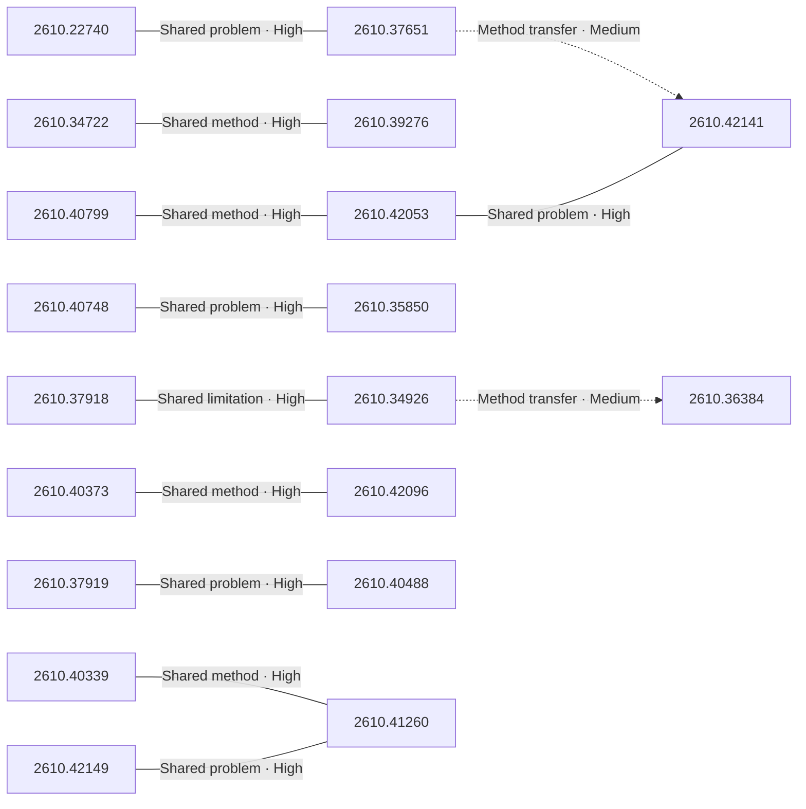

# Paper relationship graph — 2026-11-02

> [← Daily summary](../2026-11-02.md)

> **Interpretation caveat:** Every edge is an evidence-screened editorial hypothesis, not proof of citation, influence, priority, historical use, dependency, or an author-claimed relationship.

## Legend

- Rectangular nodes are current-day papers; rounded nodes are previously seen candidates.
- A line has no technical direction. An arrow shows only a proposed technical flow for an enabling dependency or method transfer.
- Solid edges are high confidence; dotted edges are medium confidence. Confidence evaluates this editorial connection, not either paper.
- Relationship labels:
  - **Shared problem:** `shared_problem`
  - **Shared method:** `shared_method`
  - **Shared evaluation:** `shared_evaluation`
  - **Complementary:** `complementary`
  - **Enabling dependency:** `enabling_dependency`
  - **Method transfer:** `method_transfer`
  - **Assumption tension:** `assumption_tension`
  - **Result tension:** `result_tension`
  - **Shared limitation:** `shared_limitation`
  - **Follow-up opportunity:** `follow_up_opportunity`

## Same-day relationships

| Source paper | Target paper | Relationship | Direction | Confidence |
| --- | --- | --- | --- | --- |
| [2610.22740](2610.22740.md) | [2610.37651](2610.37651.md) | Shared problem | Not directional | High |
| [2610.34722](2610.34722.md) | [2610.39276](2610.39276.md) | Shared method | Not directional | High |
| [2610.37651](2610.37651.md) | [2610.42141](2610.42141.md) | Method transfer | Source → target | Medium |
| [2610.42053](2610.42053.md) | [2610.42141](2610.42141.md) | Shared problem | Not directional | High |
| [2610.40799](2610.40799.md) | [2610.42053](2610.42053.md) | Shared method | Not directional | High |
| [2610.34926](2610.34926.md) | [2610.36384](2610.36384.md) | Method transfer | Source → target | Medium |
| [2610.34926](2610.34926.md) | [2610.37918](2610.37918.md) | Shared limitation | Not directional | High |
| [2610.40373](2610.40373.md) | [2610.42096](2610.42096.md) | Shared method | Not directional | High |
| [2610.35850](2610.35850.md) | [2610.40748](2610.40748.md) | Shared problem | Not directional | High |
| [2610.40339](2610.40339.md) | [2610.41260](2610.41260.md) | Shared method | Not directional | High |
| [2610.41260](2610.41260.md) | [2610.42149](2610.42149.md) | Shared problem | Not directional | High |
| [2610.37919](2610.37919.md) | [2610.40488](2610.40488.md) | Shared problem | Not directional | High |

## Connections to previously seen papers

_The visual diagram is omitted because this graph is too large or dense for a readable snapshot; every edge remains in the table below._

| New paper | Previously seen paper | First seen by service | Relationship | Technical direction | Confidence |
| --- | --- | --- | --- | --- | --- |
| [2610.39086](2610.39086.md) | 2609.37267 ([Hugging Face](https://huggingface.co/papers/2609.37267) · [arXiv](https://arxiv.org/abs/2609.37267)) | 2026-10-06 | Shared problem | Not directional | Medium |
| [2610.35850](2610.35850.md) | 2610.06617 ([Hugging Face](https://huggingface.co/papers/2610.06617) · [arXiv](https://arxiv.org/abs/2610.06617)) | 2026-10-06 | Shared problem | Not directional | Medium |
| [2610.35850](2610.35850.md) | 2610.30320 ([Hugging Face](https://huggingface.co/papers/2610.30320) · [arXiv](https://arxiv.org/abs/2610.30320)) | 2026-10-23 | Shared method | Not directional | Medium |
| [2610.40748](2610.40748.md) | 2610.03391 ([Hugging Face](https://huggingface.co/papers/2610.03391) · [arXiv](https://arxiv.org/abs/2610.03391)) | 2026-10-05 | Shared problem | Not directional | Medium |
| [2610.40373](2610.40373.md) | 2610.31423 ([Hugging Face](https://huggingface.co/papers/2610.31423) · [arXiv](https://arxiv.org/abs/2610.31423)) | 2026-10-26 | Shared method | Not directional | Medium |
| [2610.40945](2610.40945.md) | 2610.23928 ([Hugging Face](https://huggingface.co/papers/2610.23928) · [arXiv](https://arxiv.org/abs/2610.23928)) | 2026-10-27 | Shared problem | Not directional | Medium |
| [2610.42141](2610.42141.md) | 2610.23479 ([Hugging Face](https://huggingface.co/papers/2610.23479) · [arXiv](https://arxiv.org/abs/2610.23479)) | 2026-10-19 | Shared method | Not directional | Medium |
| [2610.40256](2610.40256.md) | 2610.18067 ([Hugging Face](https://huggingface.co/papers/2610.18067) · [arXiv](https://arxiv.org/abs/2610.18067)) | 2026-10-14 | Shared problem | Not directional | Medium |
| [2610.34926](2610.34926.md) | 2610.34283 ([Hugging Face](https://huggingface.co/papers/2610.34283) · [arXiv](https://arxiv.org/abs/2610.34283)) | 2026-10-28 | Shared method | Not directional | Medium |
| [2610.40636](2610.40636.md) | 2610.30120 ([Hugging Face](https://huggingface.co/papers/2610.30120) · [arXiv](https://arxiv.org/abs/2610.30120)) | 2026-10-22 | Complementary | Not directional | Medium |
| [2610.40488](2610.40488.md) | 2610.28887 ([Hugging Face](https://huggingface.co/papers/2610.28887) · [arXiv](https://arxiv.org/abs/2610.28887)) | 2026-10-22 | Shared problem | Not directional | Medium |
| [2610.42136](2610.42136.md) | 2610.28594 ([Hugging Face](https://huggingface.co/papers/2610.28594) · [arXiv](https://arxiv.org/abs/2610.28594)) | 2026-10-21 | Complementary | Not directional | Medium |

## Current paper key

| Paper | Analysis |
| --- | --- |
| 2610.39497 — Does Scaling Toward AGI Depend on What System-1 Lets System-2 Execute? | [Read analysis](2610.39497.md) |
| 2610.22740 — R^2Orch: Recursive Self-Improvement for Agent Orchestration via Self-Play within a Skill-Internalization Loop | [Read analysis](2610.22740.md) |
| 2610.36545 — FrameForge: Harnessing Priors of Video Foundation Models for Unified Image Generation | [Read analysis](2610.36545.md) |
| 2610.40738 — Apriel Voice 27B Preview: An Open Model for Speech, Reasoning, and Tool Use | [Read analysis](2610.40738.md) |
| 2610.42149 — Latent Reasoning in Continuous Space for Unified Multimodal Models | [Read analysis](2610.42149.md) |
| 2610.37481 — Follow the Gradient: Tracing Safety Degradation Back to Training Data | [Read analysis](2610.37481.md) |
| 2610.42136 — ReLift: Dense 3D Tracking as Lifted Trajectory Repair | [Read analysis](2610.42136.md) |
| 2610.40339 — Wizard: Manipulate Any World in Real Time via Agentic Control | [Read analysis](2610.40339.md) |
| 2610.40373 — HiFOR: Hierarchical Foresight with Action-Guided World Grounding for Vision-Language-Action Model | [Read analysis](2610.40373.md) |
| 2610.16927 — WeFair: Fidelity-Aware Alignment from Human Feedback for Personalized Query Rewriting in Short-Video Search | [Read analysis](2610.16927.md) |
| 2610.37918 — Venus-DefakerOne2: A Vision-Forensics Foundation Model with Broader Coverage | [Read analysis](2610.37918.md) |
| 2610.34722 — CEPO: A General Framework for Improving Prompt Optimization in Multi-Agent Systems | [Read analysis](2610.34722.md) |
| 2610.40799 — CaPtain: A Pipeline for Post-Training Code-as-Policy Robot Agents | [Read analysis](2610.40799.md) |
| 2610.42053 — REA: A Routed Embodied Agent Runtime for Asynchronous Brain-Cerebellum Control | [Read analysis](2610.42053.md) |
| 2610.40636 — Probing Spatial State Representations in Visual Foundation Models | [Read analysis](2610.40636.md) |
| 2610.40748 — WorldBridge: Bridging Video and Action for Task Generalization in World Action Models | [Read analysis](2610.40748.md) |
| 2610.31222 — GLOW-FM: Efficient Generative Low-Light Image Enhancement with One-Step Latent Flow Matching | [Read analysis](2610.31222.md) |
| 2610.40256 — When Requirements Interact: Scaling Long-Horizon Coding via Interdependent Specifications | [Read analysis](2610.40256.md) |
| 2610.39086 — HALO: Human-Grounded Granular Evaluation of Proactive Agents | [Read analysis](2610.39086.md) |
| 2610.40945 — On the Origin and Evolution of Training-Inference Mismatch in LLM Reinforcement Learning | [Read analysis](2610.40945.md) |
| 2610.36384 — SOMA: A Benchmark for Fine-Grained Egocentric Behavior and Body-Motion Understanding | [Read analysis](2610.36384.md) |
| 2610.39276 — MemSteer: Turning User Histories into Supervision for Agent Memory Optimization | [Read analysis](2610.39276.md) |
| 2610.42141 — RoboArchitect: Automating the Design of Robotic Agents with Persistent Memory | [Read analysis](2610.42141.md) |
| 2610.37651 — GEPA-Curator: Curated Learning for Self Improving Agents | [Read analysis](2610.37651.md) |
| 2610.35850 — OSWAM: An Effective World Action Model with One-Step Action Generation | [Read analysis](2610.35850.md) |
| 2610.34926 — Supervising the Visible State: Separating Representation from View Selection in Streaming Video | [Read analysis](2610.34926.md) |
| 2610.40914 — No Channels Left Behind: Understanding Diffusion Acceleration through Residual Gates | [Read analysis](2610.40914.md) |
| 2610.37903 — Think Twice: The Metis-1.6 Technical Report | [Read analysis](2610.37903.md) |
| 2610.40727 — VoxLock: Target-Speaker Extraction for Voice Agents Without an Enrollment Step | [Read analysis](2610.40727.md) |
| 2610.29617 — TernScope: Model-Hardware Co-Design for Efficient Ternary Endoscopic Segmentation | [Read analysis](2610.29617.md) |
| 2610.37919 — SciGame: Let Agents Play the Scientific Discovery Games in the Real and Counterfactual World | [Read analysis](2610.37919.md) |
| 2610.42096 — CausalWAM: Learning the Causes of Actions in World Action Models | [Read analysis](2610.42096.md) |
| 2610.40488 — rTaste: Do Research Agents Have Taste? Evaluating Early Stage Research Judgment | [Read analysis](2610.40488.md) |
| 2610.42010 — TurnTurk-GPT: Text-Based Turn-Taking Prediction for Turkish | [Read analysis](2610.42010.md) |
| 2610.37393 — Learning Quality-Controllable Robot Policies with Iterative Hindsight Relabeling | [Read analysis](2610.37393.md) |
| 2610.40901 — TSFLab: A Self-Improving Agent-Agnostic Workbench for Time Series Forecasting Research | [Read analysis](2610.40901.md) |
| 2610.41260 — SketchDirector: Complex Scene Sketching via Agentic Layout Reasoning and Detail Refinement | [Read analysis](2610.41260.md) |
| 2610.41278 — AuditFL: A Contract-Backed Clearing Layer for Open Federated Learning | [Read analysis](2610.41278.md) |

## Current papers without a published edge

- [2610.39497](2610.39497.md)
- [2610.36545](2610.36545.md)
- [2610.40738](2610.40738.md)
- [2610.37481](2610.37481.md)
- [2610.16927](2610.16927.md)
- [2610.31222](2610.31222.md)
- [2610.40914](2610.40914.md)
- [2610.37903](2610.37903.md)
- [2610.40727](2610.40727.md)
- [2610.29617](2610.29617.md)
- [2610.42010](2610.42010.md)
- [2610.37393](2610.37393.md)
- [2610.40901](2610.40901.md)
- [2610.41278](2610.41278.md)

---

[Support these research summaries on Buy Me a Coffee](https://buymeacoffee.com/vollero)
