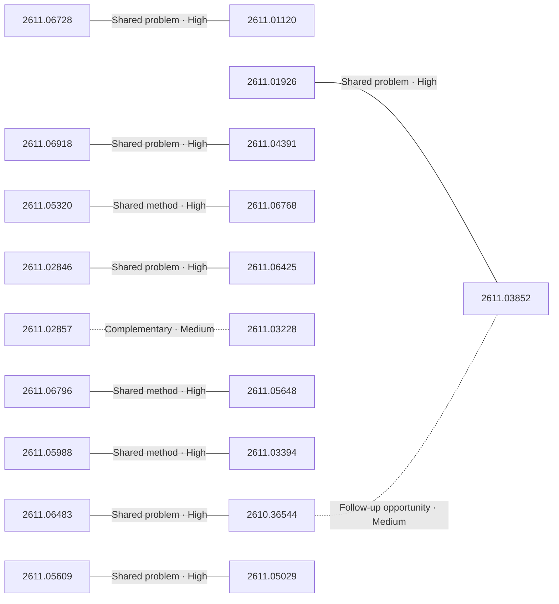

# Paper relationship graph — 2026-11-05

> [← Daily summary](../2026-11-05.md)

> **Interpretation caveat:** Every edge is an evidence-screened editorial hypothesis, not proof of citation, influence, priority, historical use, dependency, or an author-claimed relationship.

## Legend

- Rectangular nodes are current-day papers; rounded nodes are previously seen candidates.
- A line has no technical direction. An arrow shows only a proposed technical flow for an enabling dependency or method transfer.
- Solid edges are high confidence; dotted edges are medium confidence. Confidence evaluates this editorial connection, not either paper.
- Relationship labels:
  - **Shared problem:** `shared_problem`
  - **Shared method:** `shared_method`
  - **Shared evaluation:** `shared_evaluation`
  - **Complementary:** `complementary`
  - **Enabling dependency:** `enabling_dependency`
  - **Method transfer:** `method_transfer`
  - **Assumption tension:** `assumption_tension`
  - **Result tension:** `result_tension`
  - **Shared limitation:** `shared_limitation`
  - **Follow-up opportunity:** `follow_up_opportunity`

## Same-day relationships

| Source paper | Target paper | Relationship | Direction | Confidence |
| --- | --- | --- | --- | --- |
| [2610.36544](2610.36544.md) | [2611.06483](2611.06483.md) | Shared problem | Not directional | High |
| [2611.01926](2611.01926.md) | [2611.03852](2611.03852.md) | Shared problem | Not directional | High |
| [2611.02846](2611.02846.md) | [2611.06425](2611.06425.md) | Shared problem | Not directional | High |
| [2611.01120](2611.01120.md) | [2611.06728](2611.06728.md) | Shared problem | Not directional | High |
| [2611.02857](2611.02857.md) | [2611.03228](2611.03228.md) | Complementary | Not directional | Medium |
| [2611.03394](2611.03394.md) | [2611.05988](2611.05988.md) | Shared method | Not directional | High |
| [2611.04391](2611.04391.md) | [2611.06918](2611.06918.md) | Shared problem | Not directional | High |
| [2611.05029](2611.05029.md) | [2611.05609](2611.05609.md) | Shared problem | Not directional | High |
| [2611.05320](2611.05320.md) | [2611.06768](2611.06768.md) | Shared method | Not directional | High |
| [2611.05648](2611.05648.md) | [2611.06796](2611.06796.md) | Shared method | Not directional | High |
| [2610.36544](2610.36544.md) | [2611.03852](2611.03852.md) | Follow-up opportunity | Not directional | Medium |

## Connections to previously seen papers

_The visual diagram is omitted because this graph is too large or dense for a readable snapshot; every edge remains in the table below._

| New paper | Previously seen paper | First seen by service | Relationship | Technical direction | Confidence |
| --- | --- | --- | --- | --- | --- |
| [2610.41432](2610.41432.md) | 2610.22200 ([Hugging Face](https://huggingface.co/papers/2610.22200) · [arXiv](https://arxiv.org/abs/2610.22200)) | 2026-10-16 | Shared method | Not directional | High |
| [2611.03228](2611.03228.md) | 2610.03308 ([Hugging Face](https://huggingface.co/papers/2610.03308) · [arXiv](https://arxiv.org/abs/2610.03308)) | 2026-10-13 | Shared method | Not directional | High |
| [2611.03228](2611.03228.md) | 2610.18846 ([Hugging Face](https://huggingface.co/papers/2610.18846) · [arXiv](https://arxiv.org/abs/2610.18846)) | 2026-10-14 | Shared problem | Not directional | High |
| [2611.05648](2611.05648.md) | 2610.06844 ([Hugging Face](https://huggingface.co/papers/2610.06844) · [arXiv](https://arxiv.org/abs/2610.06844)) | 2026-10-07 | Shared method | Not directional | High |
| [2610.41104](2610.41104.md) | 2610.19687 ([Hugging Face](https://huggingface.co/papers/2610.19687) · [arXiv](https://arxiv.org/abs/2610.19687)) | 2026-10-26 | Complementary | Not directional | High |
| [2611.05304](2611.05304.md) | 2609.40127 ([Hugging Face](https://huggingface.co/papers/2609.40127) · [arXiv](https://arxiv.org/abs/2609.40127)) | 2026-10-07 | Shared method | Not directional | High |
| [2611.06425](2611.06425.md) | 2610.23935 ([Hugging Face](https://huggingface.co/papers/2610.23935) · [arXiv](https://arxiv.org/abs/2610.23935)) | 2026-10-20 | Shared problem | Not directional | High |
| [2611.02846](2611.02846.md) | 2610.23935 ([Hugging Face](https://huggingface.co/papers/2610.23935) · [arXiv](https://arxiv.org/abs/2610.23935)) | 2026-10-20 | Shared method | Not directional | High |
| [2611.06768](2611.06768.md) | 2610.23479 ([Hugging Face](https://huggingface.co/papers/2610.23479) · [arXiv](https://arxiv.org/abs/2610.23479)) | 2026-10-19 | Shared method | Not directional | High |
| [2611.05320](2611.05320.md) | 2610.28630 ([Hugging Face](https://huggingface.co/papers/2610.28630) · [arXiv](https://arxiv.org/abs/2610.28630)) | 2026-10-21 | Method transfer | Previous → new | Medium |
| [2611.06083](2611.06083.md) | 2610.16118 ([Hugging Face](https://huggingface.co/papers/2610.16118) · [arXiv](https://arxiv.org/abs/2610.16118)) | 2026-10-14 | Shared problem | Not directional | High |
| [2611.06910](2611.06910.md) | 2610.18092 ([Hugging Face](https://huggingface.co/papers/2610.18092) · [arXiv](https://arxiv.org/abs/2610.18092)) | 2026-10-14 | Shared method | Not directional | High |

## Current paper key

| Paper | Analysis |
| --- | --- |
| 2611.06728 — Turns Matter: Advancing Streaming Video RL via Turn-Level Credit | [Read analysis](2611.06728.md) |
| 2611.06918 — From Pixels to Actions - Towards Native Vision-Language-Action Policies | [Read analysis](2611.06918.md) |
| 2611.06910 — FrontierPhysics: Evaluating Agents for End-to-End Physics Research | [Read analysis](2611.06910.md) |
| 2611.06483 — What Does Multi-Turn Reinforcement Learning Really Improve in LLM Agents? | [Read analysis](2611.06483.md) |
| 2611.04408 — Halley: A Predictive Control Plane for Optical AI Data Center Networks | [Read analysis](2611.04408.md) |
| 2610.37257 — GameVerse: A Minute-Scale Gameplay Dataset for Long-Horizon Interactive World Modeling | [Read analysis](2610.37257.md) |
| 2611.06518 — EmoReward: Self-Evolving Reward Calibration for Emotional Video Generation RL | [Read analysis](2611.06518.md) |
| 2611.05320 — PyRUA-DataFarm: LLM Agent as a Cost-Efficient Teleoperator for Real-Ready Robot Data | [Read analysis](2611.05320.md) |
| 2611.01120 — StreamDuo: A Live Commentator and a Research Agent for Unseen Games | [Read analysis](2611.01120.md) |
| 2611.05609 — On the Generalization Limitation of On-Policy Distillation for Post-RL Consolidation | [Read analysis](2611.05609.md) |
| 2610.41104 — MUON-RT Reusing the Teacher's Trajectory for Momentum-Free Muon for LLM Self-Distillation | [Read analysis](2610.41104.md) |
| 2610.40131 — VideoMemBench: How Well Do MLLMs Remember in Video Conversations? | [Read analysis](2610.40131.md) |
| 2611.02857 — Solv3R: 3D Looped Transformer as a Multi-view Solver | [Read analysis](2611.02857.md) |
| 2611.01926 — TAC-CoT: Tool-Empowered Implicit Chain-of-Thought via Interleaving Explicit Tokens | [Read analysis](2611.01926.md) |
| 2611.02846 — SpecOPD: Branch-Parallel On-Policy Distillation for Speculative Decoding | [Read analysis](2611.02846.md) |
| 2611.04391 — Human-to-Robot Transfer via Bridging Representation and Action Space in VLAs | [Read analysis](2611.04391.md) |
| 2611.06796 — VA-TDM: A Unified View for Improving Few-Step Diffusion Models by Velocity Adversarial Distillation | [Read analysis](2611.06796.md) |
| 2610.41432 — Hybrid Computer Use: A Unified Programmatic, Semantic, and Visual Interface for General Agents | [Read analysis](2610.41432.md) |
| 2611.06768 — PyRUA-REAL: Robot Exploration and Adaptive Learning through RSI in the Real World | [Read analysis](2611.06768.md) |
| 2611.06425 — D3D: Decoupled Diffusion Drafting for Asynchronous Speculative Decoding | [Read analysis](2611.06425.md) |
| 2611.03228 — AnchorComplete: Recovering Complete Scene Meshes from Partial Point Clouds | [Read analysis](2611.03228.md) |
| 2611.03404 — VidDub: Replacement-Aware Distillation for Two-Step Video Dubbing | [Read analysis](2611.03404.md) |
| 2611.05304 — LoopVQ: Sub 1-bit KV Cache Quantization for Looped Transformers | [Read analysis](2611.05304.md) |
| 2611.03330 — The SIMPLE Law for Energy Cost of LLM Inference | [Read analysis](2611.03330.md) |
| 2611.05648 — NitroFusion2: Bringing Adversarial Loss to the Text Stream of Multimodal Diffusion Transformers | [Read analysis](2611.05648.md) |
| 2610.40516 — How I Aligned Your Model: Scaling Up Multilingual Safety Training with Templates | [Read analysis](2610.40516.md) |
| 2611.06083 — SleuthVLM: Do We Really Need Audio-in-Video for Omni Video Understanding? | [Read analysis](2611.06083.md) |
| 2611.04634 — VeriSpoof: Beyond Real or Fake with One Audio LLM | [Read analysis](2611.04634.md) |
| 2611.03768 — Multi-layer Indexer: Overlapping Selection and Attention in DeepSeek Sparse Attention | [Read analysis](2611.03768.md) |
| 2611.05988 — LiveFoley: Dynamic Real-Time Video-to-Audio Generation for Immersive Interactive Worlds | [Read analysis](2611.05988.md) |
| 2611.05593 — GaussianRenderFormer: Transformer-based Rendering of 3D Gaussian Splats | [Read analysis](2611.05593.md) |
| 2611.04760 — Koopman Generative Operators for Efficient Probabilistic Time-Series Forecasting | [Read analysis](2611.04760.md) |
| 2611.03394 — TaoMate-HD: Progressive-Resolution Autoregressive Audio-Video Generation | [Read analysis](2611.03394.md) |
| 2610.36544 — Monitor Accuracy Isn't the Answer: A Decision-Value Framework for Evaluating AI Agent Restart Monitors | [Read analysis](2610.36544.md) |
| 2611.03517 — Ask, Don't Equip: Question-Driven Coding Agents for Deep Kernel Optimization | [Read analysis](2611.03517.md) |
| 2611.03852 — Why Pay for Long Reasoning When Rewrite Do Trick? Causal Effects of Reasoning History Compaction on Future Generation and Agent Cost | [Read analysis](2611.03852.md) |
| 2611.06042 — UniRestorer++: Scalable Universal Image Restoration with Multi-Granularity Degradation Modeling | [Read analysis](2611.06042.md) |
| 2611.04949 — HERIT: Enabling Global Access to Hanja-to-English Historical Translation by Mitigating Temporal Bias | [Read analysis](2611.04949.md) |
| 2611.05029 — DRAP: Dynamics-Risk Adaptive Plasticity for Continual Learning in Physical AI | [Read analysis](2611.05029.md) |

## Current papers without a published edge

- [2611.04408](2611.04408.md)
- [2610.37257](2610.37257.md)
- [2611.06518](2611.06518.md)
- [2610.40131](2610.40131.md)
- [2611.03404](2611.03404.md)
- [2611.03330](2611.03330.md)
- [2610.40516](2610.40516.md)
- [2611.04634](2611.04634.md)
- [2611.03768](2611.03768.md)
- [2611.05593](2611.05593.md)
- [2611.04760](2611.04760.md)
- [2611.03517](2611.03517.md)
- [2611.06042](2611.06042.md)
- [2611.04949](2611.04949.md)

---

[Support these research summaries on Buy Me a Coffee](https://buymeacoffee.com/vollero)
