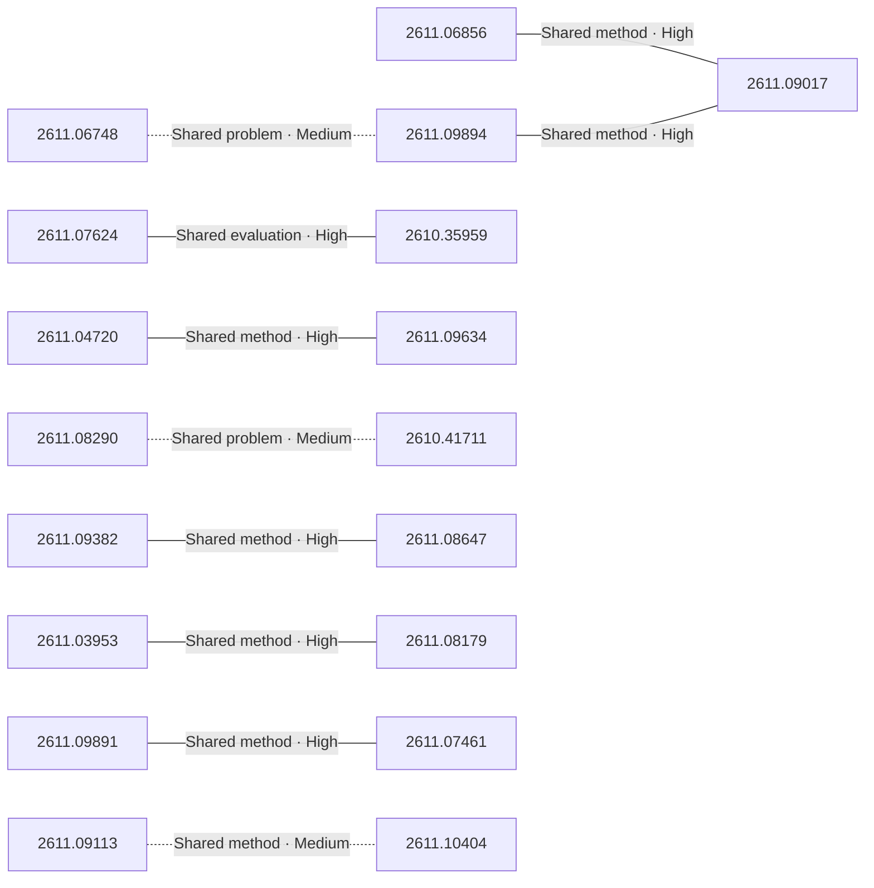

# Paper relationship graph — 2026-11-09

> [← Daily summary](../2026-11-09.md)

> **Interpretation caveat:** Every edge is an evidence-screened editorial hypothesis, not proof of citation, influence, priority, historical use, dependency, or an author-claimed relationship.

## Legend

- Rectangular nodes are current-day papers; rounded nodes are previously seen candidates.
- A line has no technical direction. An arrow shows only a proposed technical flow for an enabling dependency or method transfer.
- Solid edges are high confidence; dotted edges are medium confidence. Confidence evaluates this editorial connection, not either paper.
- Relationship labels:
  - **Shared problem:** `shared_problem`
  - **Shared method:** `shared_method`
  - **Shared evaluation:** `shared_evaluation`
  - **Complementary:** `complementary`
  - **Enabling dependency:** `enabling_dependency`
  - **Method transfer:** `method_transfer`
  - **Assumption tension:** `assumption_tension`
  - **Result tension:** `result_tension`
  - **Shared limitation:** `shared_limitation`
  - **Follow-up opportunity:** `follow_up_opportunity`

## Same-day relationships

| Source paper | Target paper | Relationship | Direction | Confidence |
| --- | --- | --- | --- | --- |
| [2611.07461](2611.07461.md) | [2611.09891](2611.09891.md) | Shared method | Not directional | High |
| [2611.08647](2611.08647.md) | [2611.09382](2611.09382.md) | Shared method | Not directional | High |
| [2611.03953](2611.03953.md) | [2611.08179](2611.08179.md) | Shared method | Not directional | High |
| [2611.04720](2611.04720.md) | [2611.09634](2611.09634.md) | Shared method | Not directional | High |
| [2610.41711](2610.41711.md) | [2611.08290](2611.08290.md) | Shared problem | Not directional | Medium |
| [2611.06748](2611.06748.md) | [2611.09894](2611.09894.md) | Shared problem | Not directional | Medium |
| [2611.06856](2611.06856.md) | [2611.09017](2611.09017.md) | Shared method | Not directional | High |
| [2611.09113](2611.09113.md) | [2611.10404](2611.10404.md) | Shared method | Not directional | Medium |
| [2611.09894](2611.09894.md) | [2611.09017](2611.09017.md) | Shared method | Not directional | High |
| [2610.35959](2610.35959.md) | [2611.07624](2611.07624.md) | Shared evaluation | Not directional | High |

## Connections to previously seen papers

_The visual diagram is omitted because this graph is too large or dense for a readable snapshot; every edge remains in the table below._

| New paper | Previously seen paper | First seen by service | Relationship | Technical direction | Confidence |
| --- | --- | --- | --- | --- | --- |
| [2610.35959](2610.35959.md) | 2610.17560 ([Hugging Face](https://huggingface.co/papers/2610.17560) · [arXiv](https://arxiv.org/abs/2610.17560)) | 2026-10-16 | Shared problem | Not directional | Medium |
| [2611.03953](2611.03953.md) | 2610.13521 ([Hugging Face](https://huggingface.co/papers/2610.13521) · [arXiv](https://arxiv.org/abs/2610.13521)) | 2026-10-15 | Shared problem | Not directional | Medium |
| [2611.02775](2611.02775.md) | 2610.19432 ([Hugging Face](https://huggingface.co/papers/2610.19432) · [arXiv](https://arxiv.org/abs/2610.19432)) | 2026-10-19 | Complementary | Not directional | Medium |
| [2611.06748](2611.06748.md) | 2611.02782 ([Hugging Face](https://huggingface.co/papers/2611.02782) · [arXiv](https://arxiv.org/abs/2611.02782)) | 2026-11-03 | Shared problem | Not directional | Medium |
| [2611.06748](2611.06748.md) | 2610.23542 ([Hugging Face](https://huggingface.co/papers/2610.23542) · [arXiv](https://arxiv.org/abs/2610.23542)) | 2026-10-19 | Follow-up opportunity | Not directional | Medium |
| [2611.06808](2611.06808.md) | 2611.01621 ([Hugging Face](https://huggingface.co/papers/2611.01621) · [arXiv](https://arxiv.org/abs/2611.01621)) | 2026-11-04 | Complementary | Not directional | Medium |
| [2611.01729](2611.01729.md) | 2610.20524 ([Hugging Face](https://huggingface.co/papers/2610.20524) · [arXiv](https://arxiv.org/abs/2610.20524)) | 2026-10-15 | Complementary | Not directional | Medium |
| [2611.07025](2611.07025.md) | 2611.05304 ([Hugging Face](https://huggingface.co/papers/2611.05304) · [arXiv](https://arxiv.org/abs/2611.05304)) | 2026-11-05 | Shared problem | Not directional | Medium |
| [2611.08179](2611.08179.md) | 2610.26397 ([Hugging Face](https://huggingface.co/papers/2610.26397) · [arXiv](https://arxiv.org/abs/2610.26397)) | 2026-10-22 | Shared method | Not directional | Medium |
| [2611.08264](2611.08264.md) | 2610.20341 ([Hugging Face](https://huggingface.co/papers/2610.20341) · [arXiv](https://arxiv.org/abs/2610.20341)) | 2026-10-16 | Shared method | Not directional | Medium |
| [2611.09017](2611.09017.md) | 2610.23986 ([Hugging Face](https://huggingface.co/papers/2610.23986) · [arXiv](https://arxiv.org/abs/2610.23986)) | 2026-10-20 | Shared evaluation | Not directional | Medium |
| [2611.10404](2611.10404.md) | 2610.34491 ([Hugging Face](https://huggingface.co/papers/2610.34491) · [arXiv](https://arxiv.org/abs/2610.34491)) | 2026-10-28 | Shared problem | Not directional | Medium |

## Current paper key

| Paper | Analysis |
| --- | --- |
| 2611.06043 — Confucius4-R2T2: A Stable-Prefix Streaming ASR Model for Real Real-Time Transcription | [Read analysis](2611.06043.md) |
| 2611.08264 — SplatAnything: Gaussian Spacing Normalization for Feed-forward 3DGS across Arbitrary Scenes | [Read analysis](2611.08264.md) |
| 2611.03953 — P^2-MOPD: Accelerating Multi-Teacher On-Policy Distillation via Parameter Priors | [Read analysis](2611.03953.md) |
| 2611.09124 — Toward the Era of Agentic Embodied Intelligence | [Read analysis](2611.09124.md) |
| 2611.08175 — PCBRouteAgent: How Close Are LLM Agents to Becoming PCB Routing Engineers? | [Read analysis](2611.08175.md) |
| 2611.04720 — OneTrans-GSR: A Generative Slate Ranking Paradigm Unifying Reranking and Mix-Ranking with One Autoregressive Transformer | [Read analysis](2611.04720.md) |
| 2611.06856 — LongBanana: An Expert-Verified Benchmark for Long-Context Multi-Reference Image Synthesis | [Read analysis](2611.06856.md) |
| 2611.06808 — LLMs Don't Know What They Know: Benchmarking Temporal Self-Knowledge for Financial Backtesting | [Read analysis](2611.06808.md) |
| 2611.07624 — Beneath the Surface: What We Overlook When We Talk About Agent Evolution | [Read analysis](2611.07624.md) |
| 2611.01182 — Fast and Exact Relative-Position Attention via Structure-Aware Kernels | [Read analysis](2611.01182.md) |
| 2611.06748 — EvoWorld: Towards Out-of-Sight World Evolution in Generative Video Models | [Read analysis](2611.06748.md) |
| 2611.09894 — Video-Coder: Reinforcing Agentic Coding for Video Generation | [Read analysis](2611.09894.md) |
| 2610.35959 — AgentBaton: Efficient Model Collaboration in Agentic Tasks | [Read analysis](2610.35959.md) |
| 2611.09382 — Exploring Weight-Space Programming: Capabilities, Generalization, and Limitations | [Read analysis](2611.09382.md) |
| 2611.09017 — Frontier3DBench: Benchmarking Coding Agents for 3D Creation across Objects, Scenes, and Interactive Open Worlds | [Read analysis](2611.09017.md) |
| 2611.07025 — LowRAM: Low-Rank Keys and Amortised Values for Composable KV Cache Compression at Test-Time | [Read analysis](2611.07025.md) |
| 2611.08290 — AutoCompress: Automated Hardware-Guided Model Compression | [Read analysis](2611.08290.md) |
| 2611.09634 — Steerable Multi-Objective Group-Relative Preference Optimization with Jointly Trained Low-Rank Adapters | [Read analysis](2611.09634.md) |
| 2610.41711 — Hierarchical Residuals: A Minimalist Decoupling of Residual Width from Compute Width | [Read analysis](2610.41711.md) |
| 2611.09891 — CPU-ARC: Agentic Reasoning Caching for on-CPU Reasoning Reuse | [Read analysis](2611.09891.md) |
| 2611.09113 — Authorization Drift in LLM Agents: Evaluating Boundary Compliance in Multi-Step Tool Use | [Read analysis](2611.09113.md) |
| 2611.02775 — Human-Centred, Risk-Constrained Evaluation of Financial Document Recognition: Evidence, Critical Errors, and Selective Automation | [Read analysis](2611.02775.md) |
| 2611.01362 — "PRISM" Is Not All You Need: Cross-Topic Name Collisions and Scientific Paper Retrieval | [Read analysis](2611.01362.md) |
| 2610.36896 — PREEN: Exemplar-Based Color Style Transfer with Smartphone Editor Presets | [Read analysis](2610.36896.md) |
| 2611.09055 — OmniLatent: Unified Latent for 3D Part Modeling | [Read analysis](2611.09055.md) |
| 2611.08647 — IWIBench: Evaluating Gradient-Free Model Driven Intra-weight Injection | [Read analysis](2611.08647.md) |
| 2611.08179 — Knowing When to Teach: Learning from Teachable Prefixes in Multilingual Reasoning Distillation | [Read analysis](2611.08179.md) |
| 2611.07461 — The Last Mile to the Real World: Agent-Native Primitives as Reusable Building Blocks for Solving Real-World Tasks | [Read analysis](2611.07461.md) |
| 2611.04434 — Sketchpad: certified exact arithmetic with a small vision-language model | [Read analysis](2611.04434.md) |
| 2611.10404 — Coding or Cheating? An Investigation of Frontier Coding LLMs | [Read analysis](2611.10404.md) |
| 2611.00448 — Learning to evolve by matching velocities | [Read analysis](2611.00448.md) |
| 2611.06844 — Where to Connect? Boosting MLLMs via Dynamic Gated Pathways across ALL ViT and LLM Layers | [Read analysis](2611.06844.md) |
| 2611.07723 — Static Recovery Is Not Dynamic Stability: Dynamics-Aware Benchmarking of Protein Motif Scaffolding | [Read analysis](2611.07723.md) |
| 2611.01729 — ODE Policy: Robot Learning via Action Dynamics, Not Actions | [Read analysis](2611.01729.md) |

## Current papers without a published edge

- [2611.06043](2611.06043.md)
- [2611.09124](2611.09124.md)
- [2611.08175](2611.08175.md)
- [2611.01182](2611.01182.md)
- [2611.01362](2611.01362.md)
- [2610.36896](2610.36896.md)
- [2611.09055](2611.09055.md)
- [2611.04434](2611.04434.md)
- [2611.00448](2611.00448.md)
- [2611.06844](2611.06844.md)
- [2611.07723](2611.07723.md)

---

[Support these research summaries on Buy Me a Coffee](https://buymeacoffee.com/vollero)
