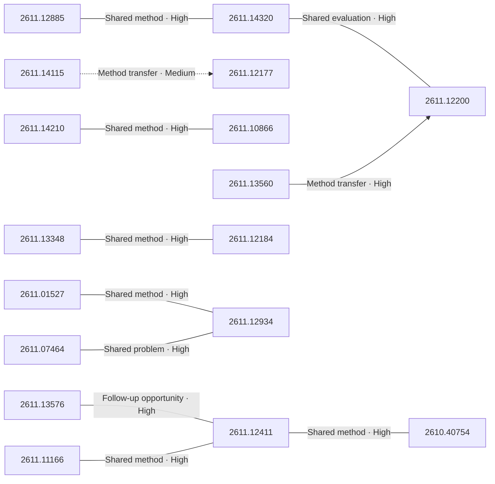

# Paper relationship graph — 2026-11-11

> [← Daily summary](../2026-11-11.md)

> **Interpretation caveat:** Every edge is an evidence-screened editorial hypothesis, not proof of citation, influence, priority, historical use, dependency, or an author-claimed relationship.

## Legend

- Rectangular nodes are current-day papers; rounded nodes are previously seen candidates.
- A line has no technical direction. An arrow shows only a proposed technical flow for an enabling dependency or method transfer.
- Solid edges are high confidence; dotted edges are medium confidence. Confidence evaluates this editorial connection, not either paper.
- Relationship labels:
  - **Shared problem:** `shared_problem`
  - **Shared method:** `shared_method`
  - **Shared evaluation:** `shared_evaluation`
  - **Complementary:** `complementary`
  - **Enabling dependency:** `enabling_dependency`
  - **Method transfer:** `method_transfer`
  - **Assumption tension:** `assumption_tension`
  - **Result tension:** `result_tension`
  - **Shared limitation:** `shared_limitation`
  - **Follow-up opportunity:** `follow_up_opportunity`

## Same-day relationships

| Source paper | Target paper | Relationship | Direction | Confidence |
| --- | --- | --- | --- | --- |
| [2610.40754](2610.40754.md) | [2611.12411](2611.12411.md) | Shared method | Not directional | High |
| [2611.12411](2611.12411.md) | [2611.13576](2611.13576.md) | Follow-up opportunity | Not directional | High |
| [2611.01527](2611.01527.md) | [2611.12934](2611.12934.md) | Shared method | Not directional | High |
| [2611.07464](2611.07464.md) | [2611.12934](2611.12934.md) | Shared problem | Not directional | High |
| [2611.12184](2611.12184.md) | [2611.13348](2611.13348.md) | Shared method | Not directional | High |
| [2611.11166](2611.11166.md) | [2611.12411](2611.12411.md) | Shared method | Not directional | High |
| [2611.12200](2611.12200.md) | [2611.14320](2611.14320.md) | Shared evaluation | Not directional | High |
| [2611.12885](2611.12885.md) | [2611.14320](2611.14320.md) | Shared method | Not directional | High |
| [2611.10866](2611.10866.md) | [2611.14210](2611.14210.md) | Shared method | Not directional | High |
| [2611.13560](2611.13560.md) | [2611.12200](2611.12200.md) | Method transfer | Source → target | High |
| [2611.14115](2611.14115.md) | [2611.12177](2611.12177.md) | Method transfer | Source → target | Medium |

## Connections to previously seen papers

_The visual diagram is omitted because this graph is too large or dense for a readable snapshot; every edge remains in the table below._

| New paper | Previously seen paper | First seen by service | Relationship | Technical direction | Confidence |
| --- | --- | --- | --- | --- | --- |
| [2611.14210](2611.14210.md) | 2610.31931 ([Hugging Face](https://huggingface.co/papers/2610.31931) · [arXiv](https://arxiv.org/abs/2610.31931)) | 2026-10-26 | Shared method | Not directional | Medium |
| [2611.14320](2611.14320.md) | 2610.27406 ([Hugging Face](https://huggingface.co/papers/2610.27406) · [arXiv](https://arxiv.org/abs/2610.27406)) | 2026-10-21 | Shared problem | Not directional | Medium |
| [2611.13576](2611.13576.md) | 2610.26711 ([Hugging Face](https://huggingface.co/papers/2610.26711) · [arXiv](https://arxiv.org/abs/2610.26711)) | 2026-10-21 | Complementary | Not directional | Medium |
| [2611.12411](2611.12411.md) | 2611.09894 ([Hugging Face](https://huggingface.co/papers/2611.09894) · [arXiv](https://arxiv.org/abs/2611.09894)) | 2026-11-09 | Shared method | Not directional | Medium |
| [2611.11166](2611.11166.md) | 2610.18568 ([Hugging Face](https://huggingface.co/papers/2610.18568) · [arXiv](https://arxiv.org/abs/2610.18568)) | 2026-10-14 | Shared method | Not directional | Medium |
| [2611.10015](2611.10015.md) | 2610.16172 ([Hugging Face](https://huggingface.co/papers/2610.16172) · [arXiv](https://arxiv.org/abs/2610.16172)) | 2026-10-14 | Shared method | Not directional | Medium |
| [2611.13560](2611.13560.md) | 2610.35497 ([Hugging Face](https://huggingface.co/papers/2610.35497) · [arXiv](https://arxiv.org/abs/2610.35497)) | 2026-11-04 | Shared problem | Not directional | Medium |
| [2611.12177](2611.12177.md) | 2610.22471 ([Hugging Face](https://huggingface.co/papers/2610.22471) · [arXiv](https://arxiv.org/abs/2610.22471)) | 2026-10-19 | Shared problem | Not directional | Medium |
| [2611.14488](2611.14488.md) | 2610.20524 ([Hugging Face](https://huggingface.co/papers/2610.20524) · [arXiv](https://arxiv.org/abs/2610.20524)) | 2026-10-15 | Follow-up opportunity | Not directional | Medium |
| [2611.12426](2611.12426.md) | 2610.37662 ([Hugging Face](https://huggingface.co/papers/2610.37662) · [arXiv](https://arxiv.org/abs/2610.37662)) | 2026-10-28 | Shared problem | Not directional | Medium |
| [2611.10649](2611.10649.md) | 2610.07121 ([Hugging Face](https://huggingface.co/papers/2610.07121) · [arXiv](https://arxiv.org/abs/2610.07121)) | 2026-10-12 | Shared method | Not directional | Medium |
| [2611.12200](2611.12200.md) | 2610.15368 ([Hugging Face](https://huggingface.co/papers/2610.15368) · [arXiv](https://arxiv.org/abs/2610.15368)) | 2026-10-16 | Shared problem | Not directional | Medium |

## Current paper key

| Paper | Analysis |
| --- | --- |
| 2611.14033 — Few-Step Streaming Video Generation via Condition Shifting | [Read analysis](2611.14033.md) |
| 2611.14210 — Tree-Ising: Repairing Language Models with Bit-Level Ising Edits | [Read analysis](2611.14210.md) |
| 2611.12885 — World In-Context Learning for Agentic Robot Manipulation | [Read analysis](2611.12885.md) |
| 2611.14320 — Don't Just Trust Your Memory: Evidence-Linked Memory Reduces Memory-Induced Degradation in LLM Agents | [Read analysis](2611.14320.md) |
| 2611.12426 — dNaViT: Discrete Codes are General-Purpose Visual Representations | [Read analysis](2611.12426.md) |
| 2611.13001 — One Table, Many Queries: Benchmarking Generalist Tabular Models Across Generation, Imputation, and Prediction | [Read analysis](2611.13001.md) |
| 2611.14309 — MMDM: Measuring Massive Multitask Decision Making | [Read analysis](2611.14309.md) |
| 2611.12177 — Embodied First Exam | [Read analysis](2611.12177.md) |
| 2611.11166 — DexForesight: Grounding Dexterous Policies with Implicit Spatial Foresight | [Read analysis](2611.11166.md) |
| 2611.07464 — FINCOSMOS: An Open-World Evaluation Paradigm for Agents in Finance | [Read analysis](2611.07464.md) |
| 2611.10649 — MACaQ: Fast, Model Agnostic Calibrated Quantization for Low-Precision Weights and Activations | [Read analysis](2611.10649.md) |
| 2611.12527 — WaveGen: Truly End-to-End Waveform Generation via Internal Spectral Trajectory Learning | [Read analysis](2611.12527.md) |
| 2611.03142 — DepthGraft: Structural Regularization through Hierarchical Cross-Layer KV Reconstruction | [Read analysis](2611.03142.md) |
| 2611.13348 — ProTEUS: A mutation-resolved world model for closed-loop protein evolution | [Read analysis](2611.13348.md) |
| 2611.13576 — PhyRubric: Rubric-Grounded Diagnostic Evaluation of Physical Commonsense in Text-to-Video Generation | [Read analysis](2611.13576.md) |
| 2611.01527 — From Tool State to Scientific Action: Auditing Decision Provenance in Biomedical Research Agents | [Read analysis](2611.01527.md) |
| 2611.10866 — The Surprising Effectiveness of Deleting Weights in LLM Post-Training | [Read analysis](2611.10866.md) |
| 2611.10486 — Test-Time Scaling for Diffusion Language Models with Frequency-Aware Remasking | [Read analysis](2611.10486.md) |
| 2611.12411 — PhysOPSD: Code as Privilege for Physically Plausible Video Generation | [Read analysis](2611.12411.md) |
| 2611.10015 — Micius-Flash: Lightweight Agentic Intelligence for Engineering | [Read analysis](2611.10015.md) |
| 2611.14488 — Is Your Robot's Memory Just a Clock? Temporal Shortcuts in Memory-Augmented VLA Policies | [Read analysis](2611.14488.md) |
| 2611.13885 — Are Causal Neuron Circuits Unique and Transferable? | [Read analysis](2611.13885.md) |
| 2611.14115 — LEASH: Stay Safe in Agentic Robotics | [Read analysis](2611.14115.md) |
| 2611.13572 — Market-Conditioned JEPA: Learning from Unpredictable Market Shocks | [Read analysis](2611.13572.md) |
| 2611.12184 — Blind Variation, Selective Retention: Improving Creative Idea Generation in AI Scientists | [Read analysis](2611.12184.md) |
| 2611.12934 — EarthRecord: From Pixels to Land Change with Multimodal Agents over Four Decades of Satellite Imagery | [Read analysis](2611.12934.md) |
| 2611.12865 — Shortcuts and Boundaries: Verifiable RL Misalignment and Contextual Safety Learning | [Read analysis](2611.12865.md) |
| 2611.13560 — Are Dense Rewards Worth Their Tokens in GRPO? | [Read analysis](2611.13560.md) |
| 2611.13482 — ExRL: Sample-Efficient Online Adaptation of Long-Chunk Policies via Execution Length Control | [Read analysis](2611.13482.md) |
| 2610.40754 — DyCraft: An Agentic System for Long-Horizon 4D Scene Generation | [Read analysis](2610.40754.md) |
| 2611.14516 — TorchCurves: Differentiable Parametric Curves | [Read analysis](2611.14516.md) |
| 2611.13907 — EVAThink: Evidence Sufficiency-Guided Training for Adaptive Thinking in Video Understanding | [Read analysis](2611.13907.md) |
| 2611.12200 — Learning to Act with World Models by Valuing What Comes Next | [Read analysis](2611.12200.md) |
| 2611.12955 — Predictive Surprise as Self-Grounding Concept Bottleneck for Interpretable Time Series | [Read analysis](2611.12955.md) |
| 2611.14116 — Visual Similarity in Adult Word Extension and Artificial Word Learning | [Read analysis](2611.14116.md) |
| 2611.14083 — Sable: A Small-Field Sumcheck Argument for Bit-Exact Inference of Large Language Models | [Read analysis](2611.14083.md) |
| 2611.13995 — Lipschitz-Controlled Flow Matching for Robust Image Restoration | [Read analysis](2611.13995.md) |
| 2611.11912 — LO-World: Unified BEV Latent Modeling for Joint 4D Occupancy and LiDAR Forecasting | [Read analysis](2611.11912.md) |
| 2611.13425 — Prompt2Echo (P2Echo): Text-Prompted Multi-View Echocardiography Segmentation with One Model | [Read analysis](2611.13425.md) |

## Current papers without a published edge

- [2611.14033](2611.14033.md)
- [2611.13001](2611.13001.md)
- [2611.14309](2611.14309.md)
- [2611.12527](2611.12527.md)
- [2611.03142](2611.03142.md)
- [2611.10486](2611.10486.md)
- [2611.13885](2611.13885.md)
- [2611.13572](2611.13572.md)
- [2611.12865](2611.12865.md)
- [2611.13482](2611.13482.md)
- [2611.14516](2611.14516.md)
- [2611.13907](2611.13907.md)
- [2611.12955](2611.12955.md)
- [2611.14116](2611.14116.md)
- [2611.14083](2611.14083.md)
- [2611.13995](2611.13995.md)
- [2611.11912](2611.11912.md)
- [2611.13425](2611.13425.md)

---

[Support these research summaries on Buy Me a Coffee](https://buymeacoffee.com/vollero)
