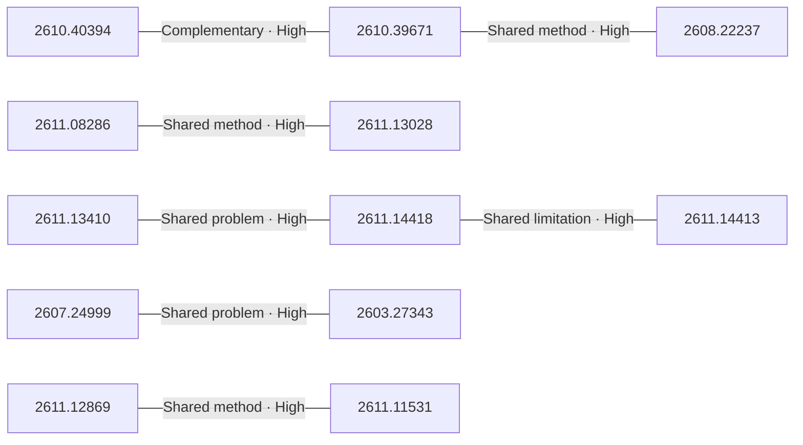

# Paper relationship graph — 2026-11-12

> [← Daily summary](../2026-11-12.md)

> **Interpretation caveat:** Every edge is an evidence-screened editorial hypothesis, not proof of citation, influence, priority, historical use, dependency, or an author-claimed relationship.

## Legend

- Rectangular nodes are current-day papers; rounded nodes are previously seen candidates.
- A line has no technical direction. An arrow shows only a proposed technical flow for an enabling dependency or method transfer.
- Solid edges are high confidence; dotted edges are medium confidence. Confidence evaluates this editorial connection, not either paper.
- Relationship labels:
  - **Shared problem:** `shared_problem`
  - **Shared method:** `shared_method`
  - **Shared evaluation:** `shared_evaluation`
  - **Complementary:** `complementary`
  - **Enabling dependency:** `enabling_dependency`
  - **Method transfer:** `method_transfer`
  - **Assumption tension:** `assumption_tension`
  - **Result tension:** `result_tension`
  - **Shared limitation:** `shared_limitation`
  - **Follow-up opportunity:** `follow_up_opportunity`

## Same-day relationships

| Source paper | Target paper | Relationship | Direction | Confidence |
| --- | --- | --- | --- | --- |
| [2603.27343](2603.27343.md) | [2607.24999](2607.24999.md) | Shared problem | Not directional | High |
| [2608.22237](2608.22237.md) | [2610.39671](2610.39671.md) | Shared method | Not directional | High |
| [2610.39671](2610.39671.md) | [2610.40394](2610.40394.md) | Complementary | Not directional | High |
| [2611.08286](2611.08286.md) | [2611.13028](2611.13028.md) | Shared method | Not directional | High |
| [2611.11531](2611.11531.md) | [2611.12869](2611.12869.md) | Shared method | Not directional | High |
| [2611.13410](2611.13410.md) | [2611.14418](2611.14418.md) | Shared problem | Not directional | High |
| [2611.14413](2611.14413.md) | [2611.14418](2611.14418.md) | Shared limitation | Not directional | High |

## Connections to previously seen papers

_The visual diagram is omitted because this graph is too large or dense for a readable snapshot; every edge remains in the table below._

| New paper | Previously seen paper | First seen by service | Relationship | Technical direction | Confidence |
| --- | --- | --- | --- | --- | --- |
| [2603.27343](2603.27343.md) | 2610.27628 ([Hugging Face](https://huggingface.co/papers/2610.27628) · [arXiv](https://arxiv.org/abs/2610.27628)) | 2026-10-21 | Shared problem | Not directional | High |
| [2608.22237](2608.22237.md) | 2610.30435 ([Hugging Face](https://huggingface.co/papers/2610.30435) · [arXiv](https://arxiv.org/abs/2610.30435)) | 2026-10-28 | Complementary | Not directional | Medium |
| [2610.39671](2610.39671.md) | 2602.05758 ([Hugging Face](https://huggingface.co/papers/2602.05758) · [arXiv](https://arxiv.org/abs/2602.05758)) | 2026-10-14 | Shared method | Not directional | Medium |
| [2611.05862](2611.05862.md) | 2610.26185 ([Hugging Face](https://huggingface.co/papers/2610.26185) · [arXiv](https://arxiv.org/abs/2610.26185)) | 2026-10-28 | Shared method | Not directional | High |
| [2611.08286](2611.08286.md) | 2610.19560 ([Hugging Face](https://huggingface.co/papers/2610.19560) · [arXiv](https://arxiv.org/abs/2610.19560)) | 2026-10-15 | Shared evaluation | Not directional | High |
| [2611.10193](2611.10193.md) | 2611.05275 ([Hugging Face](https://huggingface.co/papers/2611.05275) · [arXiv](https://arxiv.org/abs/2611.05275)) | 2026-11-04 | Shared method | Not directional | High |
| [2611.11531](2611.11531.md) | 2610.40636 ([Hugging Face](https://huggingface.co/papers/2610.40636) · [arXiv](https://arxiv.org/abs/2610.40636)) | 2026-11-02 | Shared method | Not directional | High |
| [2611.12304](2611.12304.md) | 2610.37230 ([Hugging Face](https://huggingface.co/papers/2610.37230) · [arXiv](https://arxiv.org/abs/2610.37230)) | 2026-10-29 | Complementary | Not directional | Medium |
| [2611.12869](2611.12869.md) | 2610.39302 ([Hugging Face](https://huggingface.co/papers/2610.39302) · [arXiv](https://arxiv.org/abs/2610.39302)) | 2026-10-30 | Shared problem | Not directional | High |
| [2611.13028](2611.13028.md) | 2610.19420 ([Hugging Face](https://huggingface.co/papers/2610.19420) · [arXiv](https://arxiv.org/abs/2610.19420)) | 2026-10-15 | Method transfer | Previous → new | Medium |
| [2611.13410](2611.13410.md) | 2610.34298 ([Hugging Face](https://huggingface.co/papers/2610.34298) · [arXiv](https://arxiv.org/abs/2610.34298)) | 2026-10-30 | Shared method | Not directional | Medium |
| [2611.13758](2611.13758.md) | 2611.09382 ([Hugging Face](https://huggingface.co/papers/2611.09382) · [arXiv](https://arxiv.org/abs/2611.09382)) | 2026-11-09 | Shared method | Not directional | High |

## Current paper key

| Paper | Analysis |
| --- | --- |
| 2610.40394 — Scaling Mathematical Proof Supervision from Structured Textbooks | [Read analysis](2610.40394.md) |
| 2611.13410 — SteerDistill: Quantizing LLM Agents via Closed-Loop Teacher Steering | [Read analysis](2611.13410.md) |
| 2610.39671 — Incentivizing Self-Learning in Large Language Models via Reinforcement Learning | [Read analysis](2610.39671.md) |
| 2608.22237 — Read Less, Solve More: Token-Efficient Sparse Reading of External Content for AI Agents | [Read analysis](2608.22237.md) |
| 2611.10193 — Ensemble Routing for Prompt-Adaptive Cost-Aware LLM Inference | [Read analysis](2611.10193.md) |
| 2611.08286 — Interactive Visual Gym: Evaluating Visual Interaction Models with Simulated Users in Interactive Worlds | [Read analysis](2611.08286.md) |
| 2611.13028 — GTAGym: Real AAA Game Tasks Environment for Evaluation and Reinforcement Learning | [Read analysis](2611.13028.md) |
| 2611.12304 — Evolving Infra: Agent-Adaptive LLM Serving at Scale | [Read analysis](2611.12304.md) |
| 2611.12869 — Where Does Alignment Emerge and What Does It Mean? A Closer Look at the Platonic Representation Hypothesis | [Read analysis](2611.12869.md) |
| 2611.08538 — Subliminal Learning in Vision-Language Models | [Read analysis](2611.08538.md) |
| 2611.13766 — FAME-QP: A GPU-Accelerated Quadratic-Programming Solver for Real-Time Model Predictive Control | [Read analysis](2611.13766.md) |
| 2611.14418 — Precision on Demand: Escalating Weight Bits at Uncertain Decoding Steps in a Small Local Model | [Read analysis](2611.14418.md) |
| 2607.24999 — CogBattery: Human-Referenced Evaluation of Cognitive Task Behavior and Structure in Language Models | [Read analysis](2607.24999.md) |
| 2611.05862 — CARTBench: Rubric-Based Evaluation of Shopping Advice for Complex and Ambiguous Requests with Timelines | [Read analysis](2611.05862.md) |
| 2611.13758 — Mixed Signals: Weight-Space Programming for EEG and ECG | [Read analysis](2611.13758.md) |
| 2611.08379 — Module-Aware Optimization for Graph Neural Networks | [Read analysis](2611.08379.md) |
| 2603.27343 — WMIP: A Working-Memory-Inspired Programmable Probe of Cumulative State Tracking in Large Language Models | [Read analysis](2603.27343.md) |
| 2611.11306 — ScrapeBench: Evaluating Legal Compliance of AI Agents in Website Scraping | [Read analysis](2611.11306.md) |
| 2611.14413 — Bits or permutations? Spending a fixed inference budget on weight precision or on option-order averaging in small local language models | [Read analysis](2611.14413.md) |
| 2611.13843 — PolyRoute: A Twelve-Language and Code-Mixed Benchmark for Typed-Decision Routing, with Baselines and a Leaderboard | [Read analysis](2611.13843.md) |
| 2611.11531 — Probing Transformer Representations Layer by Layer, Module by Module | [Read analysis](2611.11531.md) |

## Current papers without a published edge

- [2611.08538](2611.08538.md)
- [2611.13766](2611.13766.md)
- [2611.08379](2611.08379.md)
- [2611.11306](2611.11306.md)
- [2611.13843](2611.13843.md)

---

[Support these research summaries on Buy Me a Coffee](https://buymeacoffee.com/vollero)
