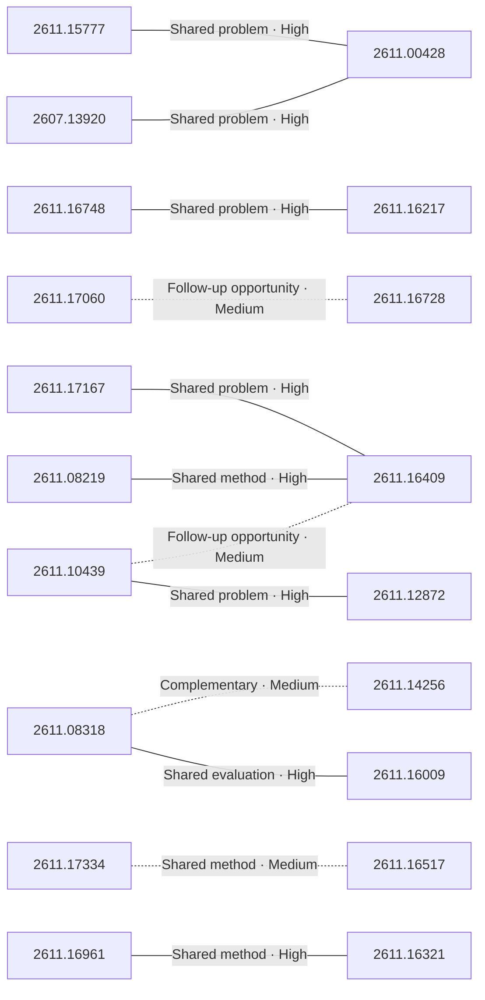

# Paper relationship graph — 2026-11-13

> [← Daily summary](../2026-11-13.md)

> **Interpretation caveat:** Every edge is an evidence-screened editorial hypothesis, not proof of citation, influence, priority, historical use, dependency, or an author-claimed relationship.

## Legend

- Rectangular nodes are current-day papers; rounded nodes are previously seen candidates.
- A line has no technical direction. An arrow shows only a proposed technical flow for an enabling dependency or method transfer.
- Solid edges are high confidence; dotted edges are medium confidence. Confidence evaluates this editorial connection, not either paper.
- Relationship labels:
  - **Shared problem:** `shared_problem`
  - **Shared method:** `shared_method`
  - **Shared evaluation:** `shared_evaluation`
  - **Complementary:** `complementary`
  - **Enabling dependency:** `enabling_dependency`
  - **Method transfer:** `method_transfer`
  - **Assumption tension:** `assumption_tension`
  - **Result tension:** `result_tension`
  - **Shared limitation:** `shared_limitation`
  - **Follow-up opportunity:** `follow_up_opportunity`

## Same-day relationships

| Source paper | Target paper | Relationship | Direction | Confidence |
| --- | --- | --- | --- | --- |
| [2607.13920](2607.13920.md) | [2611.00428](2611.00428.md) | Shared problem | Not directional | High |
| [2611.00428](2611.00428.md) | [2611.15777](2611.15777.md) | Shared problem | Not directional | High |
| [2611.10439](2611.10439.md) | [2611.12872](2611.12872.md) | Shared problem | Not directional | High |
| [2611.08318](2611.08318.md) | [2611.16009](2611.16009.md) | Shared evaluation | Not directional | High |
| [2611.08318](2611.08318.md) | [2611.14256](2611.14256.md) | Complementary | Not directional | Medium |
| [2611.08219](2611.08219.md) | [2611.16409](2611.16409.md) | Shared method | Not directional | High |
| [2611.16409](2611.16409.md) | [2611.17167](2611.17167.md) | Shared problem | Not directional | High |
| [2611.16321](2611.16321.md) | [2611.16961](2611.16961.md) | Shared method | Not directional | High |
| [2611.16517](2611.16517.md) | [2611.17334](2611.17334.md) | Shared method | Not directional | Medium |
| [2611.16217](2611.16217.md) | [2611.16748](2611.16748.md) | Shared problem | Not directional | High |
| [2611.17060](2611.17060.md) | [2611.16728](2611.16728.md) | Follow-up opportunity | Not directional | Medium |
| [2611.16409](2611.16409.md) | [2611.10439](2611.10439.md) | Follow-up opportunity | Not directional | Medium |

## Connections to previously seen papers

_The visual diagram is omitted because this graph is too large or dense for a readable snapshot; every edge remains in the table below._

| New paper | Previously seen paper | First seen by service | Relationship | Technical direction | Confidence |
| --- | --- | --- | --- | --- | --- |
| [2611.08219](2611.08219.md) | 2610.04906 ([Hugging Face](https://huggingface.co/papers/2610.04906) · [arXiv](https://arxiv.org/abs/2610.04906)) | 2026-10-14 | Shared method | Not directional | Medium |
| [2611.12872](2611.12872.md) | 2610.06830 ([Hugging Face](https://huggingface.co/papers/2610.06830) · [arXiv](https://arxiv.org/abs/2610.06830)) | 2026-10-20 | Shared problem | Not directional | Medium |
| [2611.13004](2611.13004.md) | 2610.20818 ([Hugging Face](https://huggingface.co/papers/2610.20818) · [arXiv](https://arxiv.org/abs/2610.20818)) | 2026-10-16 | Shared method | Not directional | Medium |
| [2610.41453](2610.41453.md) | 2610.18082 ([Hugging Face](https://huggingface.co/papers/2610.18082) · [arXiv](https://arxiv.org/abs/2610.18082)) | 2026-10-19 | Shared problem | Not directional | Medium |
| [2611.14815](2611.14815.md) | 2610.28632 ([Hugging Face](https://huggingface.co/papers/2610.28632) · [arXiv](https://arxiv.org/abs/2610.28632)) | 2026-10-21 | Shared method | Not directional | Medium |
| [2611.16217](2611.16217.md) | 2610.39419 ([Hugging Face](https://huggingface.co/papers/2610.39419) · [arXiv](https://arxiv.org/abs/2610.39419)) | 2026-11-03 | Shared method | Not directional | Medium |
| [2611.16728](2611.16728.md) | 2610.34186 ([Hugging Face](https://huggingface.co/papers/2610.34186) · [arXiv](https://arxiv.org/abs/2610.34186)) | 2026-10-29 | Shared problem | Not directional | Medium |
| [2611.17167](2611.17167.md) | 2610.20597 ([Hugging Face](https://huggingface.co/papers/2610.20597) · [arXiv](https://arxiv.org/abs/2610.20597)) | 2026-10-20 | Complementary | Not directional | Medium |
| [2611.16409](2611.16409.md) | 2611.13560 ([Hugging Face](https://huggingface.co/papers/2611.13560) · [arXiv](https://arxiv.org/abs/2611.13560)) | 2026-11-11 | Follow-up opportunity | Not directional | Medium |
| [2611.10439](2611.10439.md) | 2610.37624 ([Hugging Face](https://huggingface.co/papers/2610.37624) · [arXiv](https://arxiv.org/abs/2610.37624)) | 2026-10-28 | Follow-up opportunity | Not directional | Medium |
| [2611.17336](2611.17336.md) | 2610.14293 ([Hugging Face](https://huggingface.co/papers/2610.14293) · [arXiv](https://arxiv.org/abs/2610.14293)) | 2026-10-14 | Method transfer | Previous → new | Medium |
| [2611.16517](2611.16517.md) | 2611.05280 ([Hugging Face](https://huggingface.co/papers/2611.05280) · [arXiv](https://arxiv.org/abs/2611.05280)) | 2026-11-04 | Follow-up opportunity | Not directional | Medium |

## Current paper key

| Paper | Analysis |
| --- | --- |
| 2611.15777 — SO-Arena: Benchmarking the Capability Spectrum and Reliability of System One Models | [Read analysis](2611.15777.md) |
| 2611.14815 — BirdDreams: Joint Perspective and BEV Video Generation for a Plausible, Reactive Driving World Model | [Read analysis](2611.14815.md) |
| 2611.16748 — PhysLoop: Harnessing LLMs' Physics Awareness for Self-Improving Video Generation Models | [Read analysis](2611.16748.md) |
| 2611.13004 — G-STAR: Group-Scaled Token Capacity for Deeply Compressed Autoregressive Generation | [Read analysis](2611.13004.md) |
| 2611.15131 — Duo: A Reciprocal World Model for Full-Duplex Interaction | [Read analysis](2611.15131.md) |
| 2611.15844 — Open Vision Banana: A Fully Open Recipe for Generative Visual Perception | [Read analysis](2611.15844.md) |
| 2611.17167 — Actor, Judge, or Teacher? Understanding Decision Models in Long-Horizon Agents | [Read analysis](2611.17167.md) |
| 2611.17060 — Ropedia Xperience 2: A Gold Standard for Scaling Physical AI Environments and Behaviors | [Read analysis](2611.17060.md) |
| 2611.05984 — On the Design of Hyper-Connections: Simplification, Stability, and Scalability | [Read analysis](2611.05984.md) |
| 2611.17331 — TTB: Test-time Baking for Efficient Rendering of Decoder-only View Synthesis Models | [Read analysis](2611.17331.md) |
| 2611.08318 — Learning the Task or Learning the Verifier? Rethinking Criteria Exposure in Embodied Self-Improvement | [Read analysis](2611.08318.md) |
| 2611.16217 — WorldDraft: If Code Builds the World, Can Video Models Just Render It? | [Read analysis](2611.16217.md) |
| 2611.17334 — Unbundling Multimodal Vision Encoding | [Read analysis](2611.17334.md) |
| 2611.16905 — Factored One-sided Adam-Moment for Practical and Scalable SOAP | [Read analysis](2611.16905.md) |
| 2611.16517 — UniSpark: Exploring Hybrid Attention for Multimodal Understanding and Generation | [Read analysis](2611.16517.md) |
| 2611.10439 — Who Remembers What? Multi-Granularity Memory Extraction for Multi-User, Multi-Agent Interaction | [Read analysis](2611.10439.md) |
| 2611.09567 — TurtLES: A Large-Scale Benchmark for Turbulent 3D Neural PDE Surrogates | [Read analysis](2611.09567.md) |
| 2611.17190 — Consensus Capture in Reference-Based UAV Video Stabilization: A Benchmark on Dynamic Urban Scenes | [Read analysis](2611.17190.md) |
| 2611.16009 — JustRUA: A Controlled Study of GPT-6 Robot-Use Agents | [Read analysis](2611.16009.md) |
| 2607.13920 — DeepStress: Stress-Testing Deep Search Agents | [Read analysis](2607.13920.md) |
| 2611.12872 — HiVe-Mem: Interleaving Horizontal Memory Expansion and Vertical Evidence Composition for Multimodal Agents | [Read analysis](2611.12872.md) |
| 2611.08219 — Agent-R^2: Scaling Agents for Realistic Productivity Work via Real-Source Data Synthesis | [Read analysis](2611.08219.md) |
| 2610.41453 — Evidence-Guided Recovery for AI Agents with Ambiguous Tool Outcomes and Partial Execution | [Read analysis](2610.41453.md) |
| 2611.00428 — Do Multimodal Models Decide Consistently on Equivalent Optical Spectra? | [Read analysis](2611.00428.md) |
| 2611.17336 — Back to Pixels: Lifting Latent Video Diffusion into Pixel Space | [Read analysis](2611.17336.md) |
| 2611.16961 — The Value of Thinking: Learning When to Reason in Hybrid Decision Models | [Read analysis](2611.16961.md) |
| 2611.12750 — The Narrative Gap: Can LLMs Help Us Navigate Diverse Narratives Across Languages? | [Read analysis](2611.12750.md) |
| 2611.16409 — Experience-Handoff Reinforcement Learning for Recursive Self-Improvement | [Read analysis](2611.16409.md) |
| 2611.14046 — Structured Confidence Perturbation via Fisher Geometry for Adversarial Training | [Read analysis](2611.14046.md) |
| 2611.00359 — Humanized but Still True? Auditing Facts and Detection in AI-Text Humanizers | [Read analysis](2611.00359.md) |
| 2611.16321 — From Large Language Models to Efficient System One Models via Adaptive Computation | [Read analysis](2611.16321.md) |
| 2611.16728 — EgoX: Egocentric Cross-Embodiment Manipulation with Embodiment Dreaming | [Read analysis](2611.16728.md) |
| 2611.15094 — A frontier machine intelligence for human neuroimaging | [Read analysis](2611.15094.md) |
| 2611.14256 — A Cross-Scenario Survey and Analysis of Self-Evolving Multimodal Agents | [Read analysis](2611.14256.md) |

## Current papers without a published edge

- [2611.15131](2611.15131.md)
- [2611.15844](2611.15844.md)
- [2611.05984](2611.05984.md)
- [2611.17331](2611.17331.md)
- [2611.16905](2611.16905.md)
- [2611.09567](2611.09567.md)
- [2611.17190](2611.17190.md)
- [2611.12750](2611.12750.md)
- [2611.14046](2611.14046.md)
- [2611.00359](2611.00359.md)
- [2611.15094](2611.15094.md)

---

[Support these research summaries on Buy Me a Coffee](https://buymeacoffee.com/vollero)
