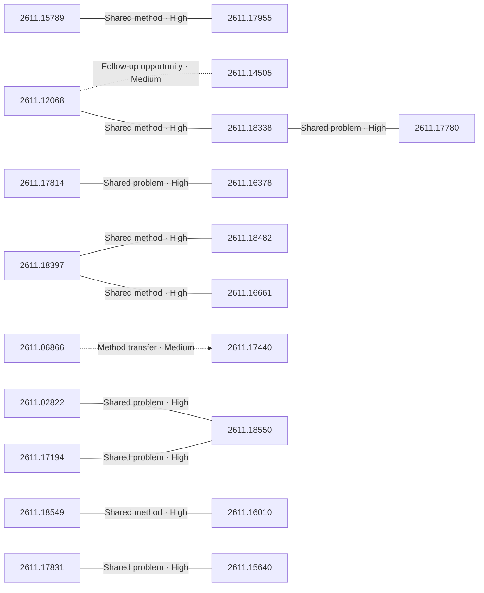

# Paper relationship graph — 2026-11-16

> [← Daily summary](../2026-11-16.md)

> **Interpretation caveat:** Every edge is an evidence-screened editorial hypothesis, not proof of citation, influence, priority, historical use, dependency, or an author-claimed relationship.

## Legend

- Rectangular nodes are current-day papers; rounded nodes are previously seen candidates.
- A line has no technical direction. An arrow shows only a proposed technical flow for an enabling dependency or method transfer.
- Solid edges are high confidence; dotted edges are medium confidence. Confidence evaluates this editorial connection, not either paper.
- Relationship labels:
  - **Shared problem:** `shared_problem`
  - **Shared method:** `shared_method`
  - **Shared evaluation:** `shared_evaluation`
  - **Complementary:** `complementary`
  - **Enabling dependency:** `enabling_dependency`
  - **Method transfer:** `method_transfer`
  - **Assumption tension:** `assumption_tension`
  - **Result tension:** `result_tension`
  - **Shared limitation:** `shared_limitation`
  - **Follow-up opportunity:** `follow_up_opportunity`

## Same-day relationships

| Source paper | Target paper | Relationship | Direction | Confidence |
| --- | --- | --- | --- | --- |
| [2611.02822](2611.02822.md) | [2611.18550](2611.18550.md) | Shared problem | Not directional | High |
| [2611.17194](2611.17194.md) | [2611.18550](2611.18550.md) | Shared problem | Not directional | High |
| [2611.16010](2611.16010.md) | [2611.18549](2611.18549.md) | Shared method | Not directional | High |
| [2611.06866](2611.06866.md) | [2611.17440](2611.17440.md) | Method transfer | Source → target | Medium |
| [2611.12068](2611.12068.md) | [2611.14505](2611.14505.md) | Follow-up opportunity | Not directional | Medium |
| [2611.12068](2611.12068.md) | [2611.18338](2611.18338.md) | Shared method | Not directional | High |
| [2611.15640](2611.15640.md) | [2611.17831](2611.17831.md) | Shared problem | Not directional | High |
| [2611.16378](2611.16378.md) | [2611.17814](2611.17814.md) | Shared problem | Not directional | High |
| [2611.15789](2611.15789.md) | [2611.17955](2611.17955.md) | Shared method | Not directional | High |
| [2611.17780](2611.17780.md) | [2611.18338](2611.18338.md) | Shared problem | Not directional | High |
| [2611.18397](2611.18397.md) | [2611.18482](2611.18482.md) | Shared method | Not directional | High |
| [2611.16661](2611.16661.md) | [2611.18397](2611.18397.md) | Shared method | Not directional | High |

## Connections to previously seen papers

_The visual diagram is omitted because this graph is too large or dense for a readable snapshot; every edge remains in the table below._

| New paper | Previously seen paper | First seen by service | Relationship | Technical direction | Confidence |
| --- | --- | --- | --- | --- | --- |
| [2610.41354](2610.41354.md) | 2610.07052 ([Hugging Face](https://huggingface.co/papers/2610.07052) · [arXiv](https://arxiv.org/abs/2610.07052)) | 2026-10-19 | Shared problem | Not directional | High |
| [2611.02822](2611.02822.md) | 2611.02782 ([Hugging Face](https://huggingface.co/papers/2611.02782) · [arXiv](https://arxiv.org/abs/2611.02782)) | 2026-11-03 | Shared problem | Not directional | High |
| [2611.07226](2611.07226.md) | 2610.23036 ([Hugging Face](https://huggingface.co/papers/2610.23036) · [arXiv](https://arxiv.org/abs/2610.23036)) | 2026-10-19 | Shared method | Not directional | High |
| [2611.16439](2611.16439.md) | 2610.18950 ([Hugging Face](https://huggingface.co/papers/2610.18950) · [arXiv](https://arxiv.org/abs/2610.18950)) | 2026-10-21 | Shared problem | Not directional | High |
| [2611.15640](2611.15640.md) | 2610.40131 ([Hugging Face](https://huggingface.co/papers/2610.40131) · [arXiv](https://arxiv.org/abs/2610.40131)) | 2026-11-05 | Shared problem | Not directional | High |
| [2611.15789](2611.15789.md) | 2610.35864 ([Hugging Face](https://huggingface.co/papers/2610.35864) · [arXiv](https://arxiv.org/abs/2610.35864)) | 2026-10-28 | Shared evaluation | Not directional | High |
| [2611.16010](2611.16010.md) | 2611.15844 ([Hugging Face](https://huggingface.co/papers/2611.15844) · [arXiv](https://arxiv.org/abs/2611.15844)) | 2026-11-13 | Shared method | Not directional | High |
| [2611.17321](2611.17321.md) | 2610.31651 ([Hugging Face](https://huggingface.co/papers/2610.31651) · [arXiv](https://arxiv.org/abs/2610.31651)) | 2026-10-23 | Method transfer | Previous → new | Medium |
| [2611.17440](2611.17440.md) | 2610.19425 ([Hugging Face](https://huggingface.co/papers/2610.19425) · [arXiv](https://arxiv.org/abs/2610.19425)) | 2026-10-21 | Shared problem | Not directional | High |
| [2611.17780](2611.17780.md) | 2610.36915 ([Hugging Face](https://huggingface.co/papers/2610.36915) · [arXiv](https://arxiv.org/abs/2610.36915)) | 2026-11-04 | Shared method | Not directional | High |
| [2611.17194](2611.17194.md) | 2611.06796 ([Hugging Face](https://huggingface.co/papers/2611.06796) · [arXiv](https://arxiv.org/abs/2611.06796)) | 2026-11-05 | Shared problem | Not directional | High |
| [2611.17814](2611.17814.md) | 2610.27227 ([Hugging Face](https://huggingface.co/papers/2610.27227) · [arXiv](https://arxiv.org/abs/2610.27227)) | 2026-10-22 | Shared method | Not directional | High |

## Current paper key

| Paper | Analysis |
| --- | --- |
| 2611.18359 — Envisioning Agentic Robotics: A New Era of Robotic Systems | [Read analysis](2611.18359.md) |
| 2611.18397 — Gamer: A Generalist Vision-Language-Action Foundation Model for Long-Horizon Real-Time Game Agent | [Read analysis](2611.18397.md) |
| 2611.15789 — VibePrevisBench: Evaluating Agentic Coding for 4D Scene Generation in Blender | [Read analysis](2611.15789.md) |
| 2611.12068 — MIRIX-2.0: Multi-Agent Memory System | [Read analysis](2611.12068.md) |
| 2611.12901 — Rethinking in Spikes: Mitigating Hallucinations in MDLMs with Step-Aware Decoding | [Read analysis](2611.12901.md) |
| 2611.18482 — MMFlash: Faster Speculative Decoding for Vision-Language Models | [Read analysis](2611.18482.md) |
| 2611.17831 — V-JEPA-LM: Video-Language Models That Read Dynamics Beyond Static, Text-Aligned Representations | [Read analysis](2611.17831.md) |
| 2611.17878 — DySENSE: Dynamic Spatiotemporal ENergy Synthesis and Emulation with Satellite Imagery | [Read analysis](2611.17878.md) |
| 2611.07226 — Loopback Transformer: Towards a Unified View of Residual Looped Transformers | [Read analysis](2611.07226.md) |
| 2611.13509 — Mobile AI Factory: Building Specialized Language Models for Your Mobile Device | [Read analysis](2611.13509.md) |
| 2611.17814 — G-CAST: Governed Continual Self-Training for E-Commerce Agents under Evolving Demands | [Read analysis](2611.17814.md) |
| 2611.18338 — MEM-SQL: Memory-Empowered Text-to-SQL | [Read analysis](2611.18338.md) |
| 2611.18549 — JVT: Just Video Transformer makes pixel-space video diffusion simple | [Read analysis](2611.18549.md) |
| 2611.17955 — WebArena-Pro: A Heterogeneous, Multimodal, Reproducible Benchmark for Web Agents | [Read analysis](2611.17955.md) |
| 2611.17820 — Aligning AI Teams | [Read analysis](2611.17820.md) |
| 2611.18442 — CANTraj: Recovering Vehicle Trajectories from CAN Signals in Naturalistic Driving | [Read analysis](2611.18442.md) |
| 2611.06866 — GH-AWTrace: A Large-Scale Dataset of GitHub Agentic Workflow Execution Logs | [Read analysis](2611.06866.md) |
| 2611.16378 — Evidence-Governed Adoption of Self-Generated Updates in Autonomous AI Agents | [Read analysis](2611.16378.md) |
| 2611.18529 — eDIAR: Training-Free Open-Speaker Streaming Diarization for Long Meetings and Large Archives via e-means | [Read analysis](2611.18529.md) |
| 2611.17440 — Interpreting Coding Agents Through Their Behavioral Trajectories | [Read analysis](2611.17440.md) |
| 2611.14505 — Continual-ARC: Measuring Skill Acquisition over a Working Lifetime | [Read analysis](2611.14505.md) |
| 2611.18429 — Do Underwater Image Quality Metrics Agree with Human Perception? A Benchmark with Human Choices, Simple Edits and Generative Drift | [Read analysis](2611.18429.md) |
| 2611.17811 — AI Reviews Are Biased Towards the Appendix | [Read analysis](2611.17811.md) |
| 2611.14504 — Emergent Biological Capabilities in a Foundation Model for Molecular Interactions | [Read analysis](2611.14504.md) |
| 2611.16439 — HALO: Human-Aligned Data Collection for WhoLe-body MObile Manipulation | [Read analysis](2611.16439.md) |
| 2611.18130 — JFinBench: A Continuously Refreshable Japanese Financial Benchmark from the Latest Certification Exams | [Read analysis](2611.18130.md) |
| 2611.02822 — Disen-Forcing: Disentangling Semantic Anchoring from Motion for Autoregressive Video Diffusion | [Read analysis](2611.02822.md) |
| 2611.14487 — Re-Search: Dissecting LLM Ideation Through a Two-Player Questioning Game | [Read analysis](2611.14487.md) |
| 2611.17194 — eDMD: Endpoint Distribution Matching for Few-Step Diffusion Distillation | [Read analysis](2611.17194.md) |
| 2611.17169 — Parsed, Plausible, Wrong: Output Format Controls Silent Errors in Small-Model Semantic Parsing | [Read analysis](2611.17169.md) |
| 2611.18550 — Restoring Diversity in Distilled Image and Video Generators by Probing Activations | [Read analysis](2611.18550.md) |
| 2611.17780 — LuthorSQL: A One-Pass Text-to-SQL Model as System 1 for a Slower LLM Agent | [Read analysis](2611.17780.md) |
| 2611.16661 — Reducing Batch Makespan for LLM Agent Workloads through Inference-Environment Coordination | [Read analysis](2611.16661.md) |
| 2611.16010 — Iris-Z: Scaling One Generative Model Past Specialist Geometry Models | [Read analysis](2611.16010.md) |
| 2611.17321 — BrickFlow: Connectivity-Guided Brick Reconstruction | [Read analysis](2611.17321.md) |
| 2611.05843 — Dual Flow: Joint Image-Measurement Interpolation for Inverse Problems | [Read analysis](2611.05843.md) |
| 2611.16500 — EvenVLM: A Text and Multimodal Dataset for the Even Language with Vision-Language Fine-Tuning | [Read analysis](2611.16500.md) |
| 2611.15640 — MemInStream: Memorizing or Merely Recognizing? Rethinking Streaming Video Memory Evaluation | [Read analysis](2611.15640.md) |
| 2610.41354 — OneSteer: Unlocking Steerable General Humanoid Motion Tracking via One-Step Diffusion Whole-Body Control | [Read analysis](2610.41354.md) |
| 2611.16312 — Alloy: A Multi-Material Physics Engine for Robot Learning | [Read analysis](2611.16312.md) |

## Current papers without a published edge

- [2611.18359](2611.18359.md)
- [2611.12901](2611.12901.md)
- [2611.17878](2611.17878.md)
- [2611.13509](2611.13509.md)
- [2611.17820](2611.17820.md)
- [2611.18442](2611.18442.md)
- [2611.18529](2611.18529.md)
- [2611.18429](2611.18429.md)
- [2611.17811](2611.17811.md)
- [2611.14504](2611.14504.md)
- [2611.18130](2611.18130.md)
- [2611.14487](2611.14487.md)
- [2611.17169](2611.17169.md)
- [2611.05843](2611.05843.md)
- [2611.16500](2611.16500.md)
- [2611.16312](2611.16312.md)

---

[Support these research summaries on Buy Me a Coffee](https://buymeacoffee.com/vollero)
