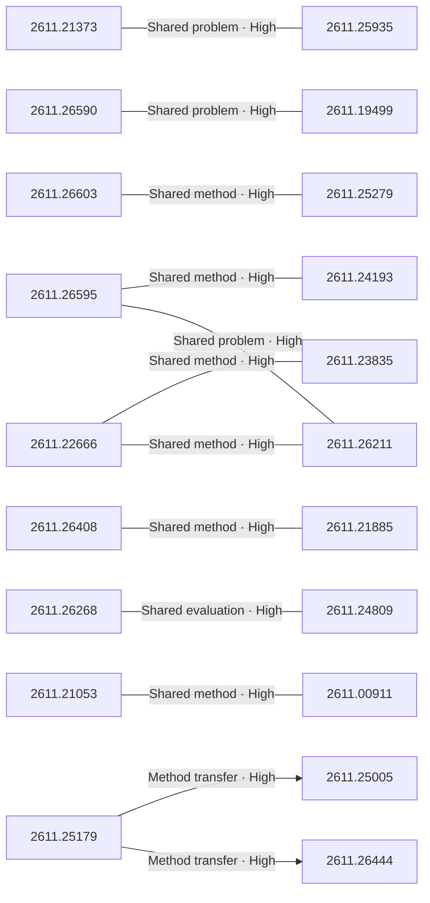

# Paper relationship graph — 2026-11-20

> [← Daily summary](../2026-11-20.md)

> **Interpretation caveat:** Every edge is an evidence-screened editorial hypothesis, not proof of citation, influence, priority, historical use, dependency, or an author-claimed relationship.

## Legend

- Rectangular nodes are current-day papers; rounded nodes are previously seen candidates.
- A line has no technical direction. An arrow shows only a proposed technical flow for an enabling dependency or method transfer.
- Solid edges are high confidence; dotted edges are medium confidence. Confidence evaluates this editorial connection, not either paper.
- Relationship labels:
  - **Shared problem:** `shared_problem`
  - **Shared method:** `shared_method`
  - **Shared evaluation:** `shared_evaluation`
  - **Complementary:** `complementary`
  - **Enabling dependency:** `enabling_dependency`
  - **Method transfer:** `method_transfer`
  - **Assumption tension:** `assumption_tension`
  - **Result tension:** `result_tension`
  - **Shared limitation:** `shared_limitation`
  - **Follow-up opportunity:** `follow_up_opportunity`

## Same-day relationships

| Source paper | Target paper | Relationship | Direction | Confidence |
| --- | --- | --- | --- | --- |
| [2611.00911](2611.00911.md) | [2611.21053](2611.21053.md) | Shared method | Not directional | High |
| [2611.22666](2611.22666.md) | [2611.23835](2611.23835.md) | Shared method | Not directional | High |
| [2611.22666](2611.22666.md) | [2611.26211](2611.26211.md) | Shared method | Not directional | High |
| [2611.24809](2611.24809.md) | [2611.26268](2611.26268.md) | Shared evaluation | Not directional | High |
| [2611.25179](2611.25179.md) | [2611.25005](2611.25005.md) | Method transfer | Source → target | High |
| [2611.25179](2611.25179.md) | [2611.26444](2611.26444.md) | Method transfer | Source → target | High |
| [2611.25279](2611.25279.md) | [2611.26603](2611.26603.md) | Shared method | Not directional | High |
| [2611.19499](2611.19499.md) | [2611.26590](2611.26590.md) | Shared problem | Not directional | High |
| [2611.21885](2611.21885.md) | [2611.26408](2611.26408.md) | Shared method | Not directional | High |
| [2611.21373](2611.21373.md) | [2611.25935](2611.25935.md) | Shared problem | Not directional | High |
| [2611.24193](2611.24193.md) | [2611.26595](2611.26595.md) | Shared method | Not directional | High |
| [2611.26211](2611.26211.md) | [2611.26595](2611.26595.md) | Shared problem | Not directional | High |

## Connections to previously seen papers

_The visual diagram is omitted because this graph is too large or dense for a readable snapshot; every edge remains in the table below._

| New paper | Previously seen paper | First seen by service | Relationship | Technical direction | Confidence |
| --- | --- | --- | --- | --- | --- |
| [2611.25179](2611.25179.md) | 2611.08318 ([Hugging Face](https://huggingface.co/papers/2611.08318) · [arXiv](https://arxiv.org/abs/2611.08318)) | 2026-11-13 | Shared evaluation | Not directional | High |
| [2611.26617](2611.26617.md) | 2611.05377 ([Hugging Face](https://huggingface.co/papers/2611.05377) · [arXiv](https://arxiv.org/abs/2611.05377)) | 2026-11-04 | Shared method | Not directional | High |
| [2611.26595](2611.26595.md) | 2611.09894 ([Hugging Face](https://huggingface.co/papers/2611.09894) · [arXiv](https://arxiv.org/abs/2611.09894)) | 2026-11-09 | Shared method | Not directional | High |
| [2611.25935](2611.25935.md) | 2611.21114 ([Hugging Face](https://huggingface.co/papers/2611.21114) · [arXiv](https://arxiv.org/abs/2611.21114)) | 2026-11-19 | Shared method | Not directional | High |
| [2611.21053](2611.21053.md) | 2611.15777 ([Hugging Face](https://huggingface.co/papers/2611.15777) · [arXiv](https://arxiv.org/abs/2611.15777)) | 2026-11-13 | Shared problem | Not directional | High |
| [2611.26444](2611.26444.md) | 2610.27861 ([Hugging Face](https://huggingface.co/papers/2610.27861) · [arXiv](https://arxiv.org/abs/2610.27861)) | 2026-10-22 | Shared method | Not directional | High |
| [2611.24011](2611.24011.md) | 2611.24789 ([Hugging Face](https://huggingface.co/papers/2611.24789) · [arXiv](https://arxiv.org/abs/2611.24789)) | 2026-11-19 | Shared method | Not directional | High |
| [2611.26629](2611.26629.md) | 2611.17194 ([Hugging Face](https://huggingface.co/papers/2611.17194) · [arXiv](https://arxiv.org/abs/2611.17194)) | 2026-11-16 | Shared problem | Not directional | High |
| [2611.26540](2611.26540.md) | 2611.00859 ([Hugging Face](https://huggingface.co/papers/2611.00859) · [arXiv](https://arxiv.org/abs/2611.00859)) | 2026-11-03 | Shared method | Not directional | High |
| [2611.23835](2611.23835.md) | 2611.02846 ([Hugging Face](https://huggingface.co/papers/2611.02846) · [arXiv](https://arxiv.org/abs/2611.02846)) | 2026-11-05 | Complementary | Not directional | Medium |
| [2611.26211](2611.26211.md) | 2611.24408 ([Hugging Face](https://huggingface.co/papers/2611.24408) · [arXiv](https://arxiv.org/abs/2611.24408)) | 2026-11-19 | Follow-up opportunity | Not directional | Medium |
| [2611.26510](2611.26510.md) | 2611.23068 ([Hugging Face](https://huggingface.co/papers/2611.23068) · [arXiv](https://arxiv.org/abs/2611.23068)) | 2026-11-19 | Follow-up opportunity | Not directional | Medium |

## Current paper key

| Paper | Analysis |
| --- | --- |
| 2611.21373 — WeVisForensics: Self-Evolving Agent for Omni AI-Generated Video Detection | [Read analysis](2611.21373.md) |
| 2611.26444 — Mind2Act World: A Diagnostic Benchmark for Embodied Mind, Physical Action, and Mind-Action Composition in Robotic Manipulation | [Read analysis](2611.26444.md) |
| 2611.26590 — Probing the "Conscious" Mind: Selective Access and Global Workspace in Vision-Language Models | [Read analysis](2611.26590.md) |
| 2611.26409 — WeMM-Video: Pushing the Frontiers of Open-Source Omni-Modal Video Understanding | [Read analysis](2611.26409.md) |
| 2611.26629 — Posterior Matching Distillation | [Read analysis](2611.26629.md) |
| 2611.26595 — Coda-DaVinci: Reimagining Video Generation with Code2Video | [Read analysis](2611.26595.md) |
| 2611.21383 — The Mask Is Not the Object: Volumetric Supervision for 3D Gaussian Segmentation | [Read analysis](2611.21383.md) |
| 2611.26603 — Depth Pro 2: Sharp and Temporally Consistent Metric Monocular Depth | [Read analysis](2611.26603.md) |
| 2611.26380 — EgoCaptioner: Towards Comprehensive and Fine-Grained Egocentric Video Captioning | [Read analysis](2611.26380.md) |
| 2611.26107 — HiUni: Harmonizing Understanding and Generation in Shared Visual Space | [Read analysis](2611.26107.md) |
| 2611.25387 — TuringSpace: Grounding Spatial Intelligence in Action with Interactive CAPTCHAs | [Read analysis](2611.25387.md) |
| 2611.26073 — AltRA-Test: An Alternative Annotator Test for LLM Judges Without Shared Annotators | [Read analysis](2611.26073.md) |
| 2611.26414 — ZeroVLN: Learning to Navigate without Supervised Fine-Tuning of the VLM Brain | [Read analysis](2611.26414.md) |
| 2611.26627 — RL Post-Training in Diffusion Transformers Is Activation Steering | [Read analysis](2611.26627.md) |
| 2611.24011 — WAM-Policy: World Action Models with On-Policy Distillation for Quadrupedal Loco-Manipulation | [Read analysis](2611.24011.md) |
| 2611.24193 — WM^MLLM: Turning MLLMs into World Models | [Read analysis](2611.24193.md) |
| 2611.26408 — Training Vision Models for LLM-Driven Weight-Space Programming | [Read analysis](2611.26408.md) |
| 2611.26510 — AutoMaster: Autonomous Post-Training by Making the Same Model a Better Teacher | [Read analysis](2611.26510.md) |
| 2611.26268 — Accelerating Mixture of Block Attention via Dynamic Routing, KV-Centric Execution and Runtime Pipelining | [Read analysis](2611.26268.md) |
| 2611.25980 — Learning What Actions Change: Action Effect Matching for Dynamics-Faithful World Models | [Read analysis](2611.25980.md) |
| 2611.24809 — On-Policy Morphing into Hybrid Attention Models | [Read analysis](2611.24809.md) |
| 2611.25567 — Online Mistake Detection in Instruction-Conditioned Procedural Video | [Read analysis](2611.25567.md) |
| 2611.26286 — Twice-Told Critiques: Claim-Level Homogenization of Peer Review in the LLM Era | [Read analysis](2611.26286.md) |
| 2611.19230 — CompoundingKernel: Self-Improving from Zero to First | [Read analysis](2611.19230.md) |
| 2611.21885 — Language Models Can Rewrite Their Own Weights | [Read analysis](2611.21885.md) |
| 2611.20455 — Embeddings vs. Grep: Rethinking the Dense Advantage in Code Search | [Read analysis](2611.20455.md) |
| 2611.21053 — System 1 agents: a method for local, reliable and fast agentic AI | [Read analysis](2611.21053.md) |
| 2611.25279 — Accord: Universal Online Metric Localization and Dense Mapping from one Camera and an IMU | [Read analysis](2611.25279.md) |
| 2611.26248 — TwinLab-Bench: Evaluating AI Scientists in Agentic Twins of Real Labs | [Read analysis](2611.26248.md) |
| 2611.22666 — VSpark: Speculative Decoding for Autoregressive Vision-Language-Action Models | [Read analysis](2611.22666.md) |
| 2611.26511 — Direct3D-V3: Latent-Free Diffusion Transformers in the Native Voxel Domain | [Read analysis](2611.26511.md) |
| 2611.26450 — A CPU Inside an LLM: Zero-Gradient Compilation of Exact Circuits into Pretrained Weights | [Read analysis](2611.26450.md) |
| 2611.25179 — Phantom Success, Silent Failure: Auditing the Success Checkers of Simulated Manipulation Benchmarks | [Read analysis](2611.25179.md) |
| 2611.19499 — Do Probing and Steering Favor the Same Directions Within and Across Language Models? | [Read analysis](2611.19499.md) |
| 2611.26298 — DailySafe: Benchmarking Dynamic Safety Awareness in Everyday Multi-Turn Multimodal Interactions | [Read analysis](2611.26298.md) |
| 2611.23835 — NarrowSpec: Draft Hidden Width Need Not Match the Target in Speculative Decoding | [Read analysis](2611.23835.md) |
| 2611.26239 — Teaching Vision-Language-Action Models to Stop Safely | [Read analysis](2611.26239.md) |
| 2611.25604 — PAD: Policy-Aware Data Valuation for Autonomous Driving | [Read analysis](2611.25604.md) |
| 2611.26617 — One Prior, Two Dynamics: Repurposing Video Diffusion Transformers for Self-Supervised Latent Action Learning | [Read analysis](2611.26617.md) |
| 2611.25776 — Suppressing the Shortcut Hidden Behind the Gains of VideoLLM Fine-Tuning | [Read analysis](2611.25776.md) |
| 2611.25200 — Squoosh Bench: Evaluating UX-1 on 318 Historical Website A/B Tests | [Read analysis](2611.25200.md) |
| 2611.23875 — In Situ Training of Optical Neural Networks by Coding Agents | [Read analysis](2611.23875.md) |
| 2611.26211 — SpecWM: Turning Verification into Refinement for Streaming World Models | [Read analysis](2611.26211.md) |
| 2611.25005 — Inhabitant: An Agent Framework for Long-Horizon Human-Scene Interaction with Spatial Control and Quantitative Feedback | [Read analysis](2611.25005.md) |
| 2611.00911 — S1CogBench: What System One Decision Models Can and Cannot Do on Cognitive Experiments | [Read analysis](2611.00911.md) |
| 2611.26624 — PlayCraft: Designing Engaging Games from Agent Play Experience | [Read analysis](2611.26624.md) |
| 2611.26232 — Time Series Structure Learning with Local Causal Parent Discovery | [Read analysis](2611.26232.md) |
| 2611.15941 — Lang-SVG: Hierarchical Image Vectorization with Language Priors | [Read analysis](2611.15941.md) |
| 2611.26540 — AURA: AUdio-dRiven streaming Avatar | [Read analysis](2611.26540.md) |
| 2611.25935 — TwinD: Generalizing Deepfake Detection from Blending to Entire Face Synthesis | [Read analysis](2611.25935.md) |

## Current papers without a published edge

- [2611.26409](2611.26409.md)
- [2611.21383](2611.21383.md)
- [2611.26380](2611.26380.md)
- [2611.26107](2611.26107.md)
- [2611.25387](2611.25387.md)
- [2611.26073](2611.26073.md)
- [2611.26414](2611.26414.md)
- [2611.26627](2611.26627.md)
- [2611.25980](2611.25980.md)
- [2611.25567](2611.25567.md)
- [2611.26286](2611.26286.md)
- [2611.19230](2611.19230.md)
- [2611.20455](2611.20455.md)
- [2611.26248](2611.26248.md)
- [2611.26511](2611.26511.md)
- [2611.26450](2611.26450.md)
- [2611.26298](2611.26298.md)
- [2611.26239](2611.26239.md)
- [2611.25604](2611.25604.md)
- [2611.25776](2611.25776.md)
- [2611.25200](2611.25200.md)
- [2611.23875](2611.23875.md)
- [2611.26624](2611.26624.md)
- [2611.26232](2611.26232.md)
- [2611.15941](2611.15941.md)

---

[Support these research summaries on Buy Me a Coffee](https://buymeacoffee.com/vollero)
