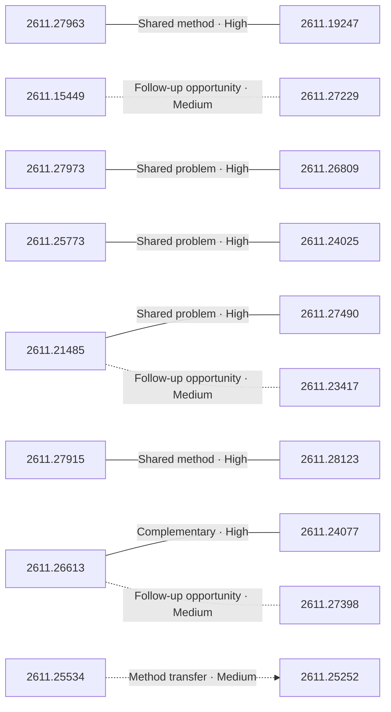

# Paper relationship graph — 2026-11-23

> [← Daily summary](../2026-11-23.md)

> **Interpretation caveat:** Every edge is an evidence-screened editorial hypothesis, not proof of citation, influence, priority, historical use, dependency, or an author-claimed relationship.

## Legend

- Rectangular nodes are current-day papers; rounded nodes are previously seen candidates.
- A line has no technical direction. An arrow shows only a proposed technical flow for an enabling dependency or method transfer.
- Solid edges are high confidence; dotted edges are medium confidence. Confidence evaluates this editorial connection, not either paper.
- Relationship labels:
  - **Shared problem:** `shared_problem`
  - **Shared method:** `shared_method`
  - **Shared evaluation:** `shared_evaluation`
  - **Complementary:** `complementary`
  - **Enabling dependency:** `enabling_dependency`
  - **Method transfer:** `method_transfer`
  - **Assumption tension:** `assumption_tension`
  - **Result tension:** `result_tension`
  - **Shared limitation:** `shared_limitation`
  - **Follow-up opportunity:** `follow_up_opportunity`

## Same-day relationships

| Source paper | Target paper | Relationship | Direction | Confidence |
| --- | --- | --- | --- | --- |
| [2611.21485](2611.21485.md) | [2611.27490](2611.27490.md) | Shared problem | Not directional | High |
| [2611.21485](2611.21485.md) | [2611.23417](2611.23417.md) | Follow-up opportunity | Not directional | Medium |
| [2611.19247](2611.19247.md) | [2611.27963](2611.27963.md) | Shared method | Not directional | High |
| [2611.24025](2611.24025.md) | [2611.25773](2611.25773.md) | Shared problem | Not directional | High |
| [2611.24077](2611.24077.md) | [2611.26613](2611.26613.md) | Complementary | Not directional | High |
| [2611.25534](2611.25534.md) | [2611.25252](2611.25252.md) | Method transfer | Source → target | Medium |
| [2611.26809](2611.26809.md) | [2611.27973](2611.27973.md) | Shared problem | Not directional | High |
| [2611.27915](2611.27915.md) | [2611.28123](2611.28123.md) | Shared method | Not directional | High |
| [2611.15449](2611.15449.md) | [2611.27229](2611.27229.md) | Follow-up opportunity | Not directional | Medium |
| [2611.27398](2611.27398.md) | [2611.26613](2611.26613.md) | Follow-up opportunity | Not directional | Medium |

## Connections to previously seen papers

_The visual diagram is omitted because this graph is too large or dense for a readable snapshot; every edge remains in the table below._

| New paper | Previously seen paper | First seen by service | Relationship | Technical direction | Confidence |
| --- | --- | --- | --- | --- | --- |
| [2611.19247](2611.19247.md) | 2611.22925 ([Hugging Face](https://huggingface.co/papers/2611.22925) · [arXiv](https://arxiv.org/abs/2611.22925)) | 2026-11-19 | Shared method | Not directional | High |
| [2611.23417](2611.23417.md) | 2611.02782 ([Hugging Face](https://huggingface.co/papers/2611.02782) · [arXiv](https://arxiv.org/abs/2611.02782)) | 2026-11-03 | Shared problem | Not directional | High |
| [2611.24025](2611.24025.md) | 2611.07222 ([Hugging Face](https://huggingface.co/papers/2611.07222) · [arXiv](https://arxiv.org/abs/2611.07222)) | 2026-11-17 | Complementary | Not directional | High |
| [2611.24077](2611.24077.md) | 2610.39287 ([Hugging Face](https://huggingface.co/papers/2610.39287) · [arXiv](https://arxiv.org/abs/2610.39287)) | 2026-10-30 | Follow-up opportunity | Not directional | Medium |
| [2611.25534](2611.25534.md) | 2610.34238 ([Hugging Face](https://huggingface.co/papers/2610.34238) · [arXiv](https://arxiv.org/abs/2610.34238)) | 2026-10-27 | Follow-up opportunity | Not directional | Medium |
| [2611.25773](2611.25773.md) | 2611.17048 ([Hugging Face](https://huggingface.co/papers/2611.17048) · [arXiv](https://arxiv.org/abs/2611.17048)) | 2026-11-18 | Shared problem | Not directional | High |
| [2611.26613](2611.26613.md) | 2611.26444 ([Hugging Face](https://huggingface.co/papers/2611.26444) · [arXiv](https://arxiv.org/abs/2611.26444)) | 2026-11-20 | Complementary | Not directional | High |
| [2611.26954](2611.26954.md) | 2610.38681 ([Hugging Face](https://huggingface.co/papers/2610.38681) · [arXiv](https://arxiv.org/abs/2610.38681)) | 2026-10-30 | Shared method | Not directional | High |
| [2611.27193](2611.27193.md) | 2611.05984 ([Hugging Face](https://huggingface.co/papers/2611.05984) · [arXiv](https://arxiv.org/abs/2611.05984)) | 2026-11-13 | Shared problem | Not directional | High |
| [2611.27229](2611.27229.md) | 2610.33472 ([Hugging Face](https://huggingface.co/papers/2610.33472) · [arXiv](https://arxiv.org/abs/2610.33472)) | 2026-10-27 | Shared problem | Not directional | High |
| [2611.27915](2611.27915.md) | 2610.36022 ([Hugging Face](https://huggingface.co/papers/2610.36022) · [arXiv](https://arxiv.org/abs/2610.36022)) | 2026-10-28 | Shared problem | Not directional | High |
| [2611.27963](2611.27963.md) | 2611.24408 ([Hugging Face](https://huggingface.co/papers/2611.24408) · [arXiv](https://arxiv.org/abs/2611.24408)) | 2026-11-19 | Complementary | Not directional | High |

## Current paper key

| Paper | Analysis |
| --- | --- |
| 2611.27193 — cmHC: Balancing Stream Mixing in Hyper-Connections via Geometric Contraction | [Read analysis](2611.27193.md) |
| 2611.27963 — Non-penetrating World Models | [Read analysis](2611.27963.md) |
| 2611.24636 — Clover-35B-A3B-Preview Technical Report | [Read analysis](2611.24636.md) |
| 2611.26954 — Learning Video Foresight Reasoning from Unlabeled Videos via On-Policy Self-Distillation | [Read analysis](2611.26954.md) |
| 2611.15449 — Reading the Unreadable: Text-Aware Image Super-Resolution Needs Reasoning | [Read analysis](2611.15449.md) |
| 2611.27973 — MemOnce: A Scalable Memory Architecture for Large Language Models | [Read analysis](2611.27973.md) |
| 2611.25773 — Duopra: From Full-Duplex Conversation to Full-Duplex Agency | [Read analysis](2611.25773.md) |
| 2611.21485 — Lost in the Hallway: Benchmarking Persistent Spatial Memory Across Revisits | [Read analysis](2611.21485.md) |
| 2611.27915 — StereoVLM: Binocular Vision-Language Models for Metric 3D Spatial Reasoning | [Read analysis](2611.27915.md) |
| 2611.26613 — AgentRoboCritic: Understanding the Capability of Frontier Agents on Direct Robot Control | [Read analysis](2611.26613.md) |
| 2611.24077 — AeroRSI: Recursive Self-Improvement for Aerial Vision-Language Navigation | [Read analysis](2611.24077.md) |
| 2611.22343 — PURE: A Diagnostic Benchmark for Multi-Granularity Multimodal Identity Matching | [Read analysis](2611.22343.md) |
| 2611.27398 — Taking Apart and Putting Together: Tracking Objects Through Physical Transformations | [Read analysis](2611.27398.md) |
| 2611.28123 — Seeing the Invisible: How Vision-Language Models Read, Predict and Trace Radio Fields | [Read analysis](2611.28123.md) |
| 2611.24249 — From Points to Trajectories: Rethinking Multimodal Alignment for Physical Events | [Read analysis](2611.24249.md) |
| 2611.25252 — Moving Generality from Model to Modeler: LLM Agents for PHM on a Deployment-Style Benchmark | [Read analysis](2611.25252.md) |
| 2611.24025 — Intent Contracts: Taking Tools Away from Agents | [Read analysis](2611.24025.md) |
| 2611.27229 — Prune to Expand: Training Prompt Enhancers with Less to Imitate | [Read analysis](2611.27229.md) |
| 2611.25534 — How Feedback-Free Self-Evolution Reshapes Agent Skills: A Systematic Study | [Read analysis](2611.25534.md) |
| 2611.22479 — Exploited Before It Was Fixed? Vulnerability Timelines from Open, Machine-Readable Evidence | [Read analysis](2611.22479.md) |
| 2611.19247 — GameWM: Toward Next-Generation Video Games with Interaction-Centric World Models | [Read analysis](2611.19247.md) |
| 2611.27211 — Explicit Style Extraction for Personalized Long-Form Text Generation | [Read analysis](2611.27211.md) |
| 2611.27490 — Which Dwarf Is This? Doppeldwarf-306 and Near-Identical Instance Retrieval | [Read analysis](2611.27490.md) |
| 2611.26809 — Search From the Start: Search-Native Pretraining for Language Models | [Read analysis](2611.26809.md) |
| 2611.22495 — Motion-Aware Reward Modeling for Instruction-Guided Video Editing | [Read analysis](2611.22495.md) |
| 2611.23417 — Autoregressive View Model | [Read analysis](2611.23417.md) |

## Current papers without a published edge

- [2611.24636](2611.24636.md)
- [2611.22343](2611.22343.md)
- [2611.24249](2611.24249.md)
- [2611.22479](2611.22479.md)
- [2611.27211](2611.27211.md)
- [2611.22495](2611.22495.md)

---

[Support these research summaries on Buy Me a Coffee](https://buymeacoffee.com/vollero)
