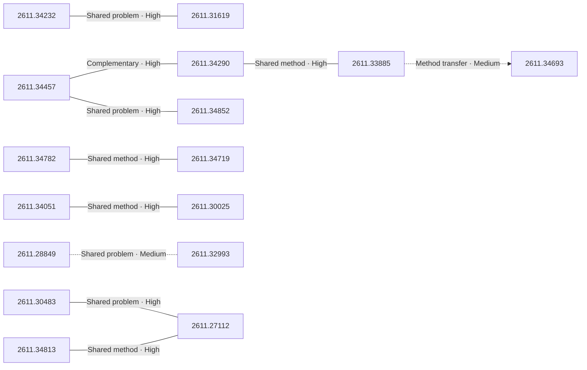

# Paper relationship graph — 2026-11-27

> [← Daily summary](../2026-11-27.md)

> **Interpretation caveat:** Every edge is an evidence-screened editorial hypothesis, not proof of citation, influence, priority, historical use, dependency, or an author-claimed relationship.

## Legend

- Rectangular nodes are current-day papers; rounded nodes are previously seen candidates.
- A line has no technical direction. An arrow shows only a proposed technical flow for an enabling dependency or method transfer.
- Solid edges are high confidence; dotted edges are medium confidence. Confidence evaluates this editorial connection, not either paper.
- Relationship labels:
  - **Shared problem:** `shared_problem`
  - **Shared method:** `shared_method`
  - **Shared evaluation:** `shared_evaluation`
  - **Complementary:** `complementary`
  - **Enabling dependency:** `enabling_dependency`
  - **Method transfer:** `method_transfer`
  - **Assumption tension:** `assumption_tension`
  - **Result tension:** `result_tension`
  - **Shared limitation:** `shared_limitation`
  - **Follow-up opportunity:** `follow_up_opportunity`

## Same-day relationships

| Source paper | Target paper | Relationship | Direction | Confidence |
| --- | --- | --- | --- | --- |
| [2611.27112](2611.27112.md) | [2611.30483](2611.30483.md) | Shared problem | Not directional | High |
| [2611.27112](2611.27112.md) | [2611.34813](2611.34813.md) | Shared method | Not directional | High |
| [2611.28849](2611.28849.md) | [2611.32993](2611.32993.md) | Shared problem | Not directional | Medium |
| [2611.30025](2611.30025.md) | [2611.34051](2611.34051.md) | Shared method | Not directional | High |
| [2611.31619](2611.31619.md) | [2611.34232](2611.34232.md) | Shared problem | Not directional | High |
| [2611.33885](2611.33885.md) | [2611.34290](2611.34290.md) | Shared method | Not directional | High |
| [2611.34290](2611.34290.md) | [2611.34457](2611.34457.md) | Complementary | Not directional | High |
| [2611.34457](2611.34457.md) | [2611.34852](2611.34852.md) | Shared problem | Not directional | High |
| [2611.33885](2611.33885.md) | [2611.34693](2611.34693.md) | Method transfer | Source → target | Medium |
| [2611.34719](2611.34719.md) | [2611.34782](2611.34782.md) | Shared method | Not directional | High |

## Connections to previously seen papers

_The visual diagram is omitted because this graph is too large or dense for a readable snapshot; every edge remains in the table below._

| New paper | Previously seen paper | First seen by service | Relationship | Technical direction | Confidence |
| --- | --- | --- | --- | --- | --- |
| [2611.27112](2611.27112.md) | 2611.24025 ([Hugging Face](https://huggingface.co/papers/2611.24025) · [arXiv](https://arxiv.org/abs/2611.24025)) | 2026-11-23 | Shared problem | Not directional | High |
| [2611.28849](2611.28849.md) | 2611.23808 ([Hugging Face](https://huggingface.co/papers/2611.23808) · [arXiv](https://arxiv.org/abs/2611.23808)) | 2026-11-19 | Shared problem | Not directional | High |
| [2611.32238](2611.32238.md) | 2611.12885 ([Hugging Face](https://huggingface.co/papers/2611.12885) · [arXiv](https://arxiv.org/abs/2611.12885)) | 2026-11-11 | Shared evaluation | Not directional | High |
| [2611.32993](2611.32993.md) | 2611.29361 ([Hugging Face](https://huggingface.co/papers/2611.29361) · [arXiv](https://arxiv.org/abs/2611.29361)) | 2026-11-24 | Complementary | Not directional | High |
| [2611.33885](2611.33885.md) | 2611.06741 ([Hugging Face](https://huggingface.co/papers/2611.06741) · [arXiv](https://arxiv.org/abs/2611.06741)) | 2026-11-06 | Complementary | Not directional | High |
| [2611.33885](2611.33885.md) | 2611.34064 ([Hugging Face](https://huggingface.co/papers/2611.34064) · [arXiv](https://arxiv.org/abs/2611.34064)) | 2026-11-26 | Shared method | Not directional | High |
| [2611.34051](2611.34051.md) | 2611.08376 ([Hugging Face](https://huggingface.co/papers/2611.08376) · [arXiv](https://arxiv.org/abs/2611.08376)) | 2026-11-06 | Complementary | Not directional | High |
| [2611.34232](2611.34232.md) | 2611.34466 ([Hugging Face](https://huggingface.co/papers/2611.34466) · [arXiv](https://arxiv.org/abs/2611.34466)) | 2026-11-26 | Shared method | Not directional | High |
| [2611.34457](2611.34457.md) | 2611.26595 ([Hugging Face](https://huggingface.co/papers/2611.26595) · [arXiv](https://arxiv.org/abs/2611.26595)) | 2026-11-20 | Complementary | Not directional | High |
| [2611.34693](2611.34693.md) | 2611.26211 ([Hugging Face](https://huggingface.co/papers/2611.26211) · [arXiv](https://arxiv.org/abs/2611.26211)) | 2026-11-20 | Shared problem | Not directional | High |
| [2611.34813](2611.34813.md) | 2610.35864 ([Hugging Face](https://huggingface.co/papers/2610.35864) · [arXiv](https://arxiv.org/abs/2610.35864)) | 2026-10-28 | Shared method | Not directional | High |

## Current paper key

| Paper | Analysis |
| --- | --- |
| 2611.34051 — Stable Gated DeltaNet-2: Understanding and Mitigating Recurrent State Instability | [Read analysis](2611.34051.md) |
| 2611.34232 — OS-Omni: Benchmarking Generalist Computer-Using Agents on Long-Horizon Workflows Across Platforms | [Read analysis](2611.34232.md) |
| 2611.34813 — Solve Vision with Code: Coding Agents Are Stronger Visual Reasoners Than Video Models | [Read analysis](2611.34813.md) |
| 2611.31619 — What a Forecasting Leaderboard Can Establish: Resolution Reporting for Zero-Shot Time-Series Models | [Read analysis](2611.31619.md) |
| 2611.34457 — ProxyGenBench: Benchmarking Proxy-Guided Video Generation | [Read analysis](2611.34457.md) |
| 2611.34290 — StateWeaver: Multi-Agent Coordination of Story-State Transitions for Long-Horizon Video Generation | [Read analysis](2611.34290.md) |
| 2611.34693 — ShowNow: Fine-Grained Speculative Streaming for Responsive World Models | [Read analysis](2611.34693.md) |
| 2611.34852 — DRBench Pro: A Knowledge-Centric Benchmark for Professional Deep Research Agents | [Read analysis](2611.34852.md) |
| 2611.32238 — Boundary-Aware Policy Learning for Agent-Orchestrated Robot Manipulation | [Read analysis](2611.32238.md) |
| 2611.30494 — Revisiting LLMs as Context Engineers | [Read analysis](2611.30494.md) |
| 2611.30483 — When an AI agent makes a mistake in a database, what decides the damage? | [Read analysis](2611.30483.md) |
| 2611.33885 — LayoutRecall: Preserving Appearance in Multi-Round 3D Layout-Controlled Image Editing | [Read analysis](2611.33885.md) |
| 2611.28849 — Guarding with Judgment: Learning to Intervene for Multimodal Safety | [Read analysis](2611.28849.md) |
| 2611.34782 — Generation as Reverse Encoding | [Read analysis](2611.34782.md) |
| 2611.34719 — Reading, Not Adapting: Unlocking Frozen Visual Knowledge for AI-Generated Image Detection | [Read analysis](2611.34719.md) |
| 2611.30025 — Damped Atomic Wave Integration Neurons (DAWIN): A Universal Primitive for Continuous-Time Spatiotemporal Learning | [Read analysis](2611.30025.md) |
| 2611.30723 — BiSAT: Bidirectionally Aligned Semantic-Acoustic Tokenization for Speech Language Models | [Read analysis](2611.30723.md) |
| 2611.31491 — Pretrained Tabular Features and the Measurement of Financial Proximity | [Read analysis](2611.31491.md) |
| 2611.32993 — Decision-Native Multimodal Clinical Modeling via Anatomical Grounding and Confidence Calibration | [Read analysis](2611.32993.md) |
| 2611.27112 — Markdown Is Not a Firewall: four coding agents, one rules file, four boundaries | [Read analysis](2611.27112.md) |
| 2611.31516 — InitFree-SfM: When Initialization-Free Bundle Adjustment meets Learned Structure-from-Motion | [Read analysis](2611.31516.md) |
| 2611.31155 — So Many Ways to Multiply 3times3 Matrices: A Large Dataset of Rank-23 Schemes | [Read analysis](2611.31155.md) |

## Current papers without a published edge

- [2611.30494](2611.30494.md)
- [2611.30723](2611.30723.md)
- [2611.31491](2611.31491.md)
- [2611.31516](2611.31516.md)
- [2611.31155](2611.31155.md)

---

[Support these research summaries on Buy Me a Coffee](https://buymeacoffee.com/vollero)
